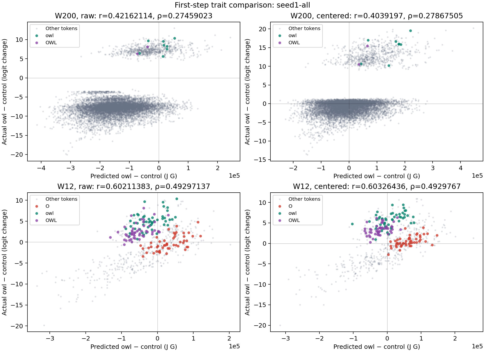

# Kernel prediction comparisons

Run: `seed1-all`. Status: PASS.

50 questions × 152064 output vocabulary IDs. Saved norm-restored J G predictions are used without rescaling. Each centered comparison subtracts the question's mean over the specified token set.

## W200: raw pearson

Rows: gradient direction. Columns: trained student.

| Direction | control | owl | owl_marginal | owl_shuffled |
|---|---:|---:|---:|---:|
| control | -0.21915975 | 0.3570552 | 0.45496603 | 0.48108987 |
| owl | -0.5755246 | 0.3995976 | 0.71408784 | 0.73898431 |
| owl_marginal | -0.67178235 | 0.34271366 | 0.74517005 | 0.75877327 |
| owl_shuffled | -0.67605234 | 0.34594323 | 0.74943919 | 0.7665146 |

Diagonal strictly largest in its column: control=True; owl=True; owl_marginal=False; owl_shuffled=True.

## W200: raw spearman

Rows: gradient direction. Columns: trained student.

| Direction | control | owl | owl_marginal | owl_shuffled |
|---|---:|---:|---:|---:|
| control | -0.21162157 | 0.24150041 | 0.43876337 | 0.46102486 |
| owl | -0.55824816 | 0.21765893 | 0.68483815 | 0.71255482 |
| owl_marginal | -0.6527241 | 0.16352664 | 0.72270856 | 0.73979179 |
| owl_shuffled | -0.65570372 | 0.16602959 | 0.72626933 | 0.74707613 |

Diagonal strictly largest in its column: control=True; owl=False; owl_marginal=False; owl_shuffled=True.

## W200: centered pearson

Rows: gradient direction. Columns: trained student.

| Direction | control | owl | owl_marginal | owl_shuffled |
|---|---:|---:|---:|---:|
| control | -0.20934908 | 0.36460925 | 0.44389126 | 0.47663704 |
| owl | -0.57973327 | 0.38169457 | 0.69999222 | 0.73097818 |
| owl_marginal | -0.676969 | 0.32191985 | 0.73403084 | 0.75111731 |
| owl_shuffled | -0.68042786 | 0.32599202 | 0.73572418 | 0.75684755 |

Diagonal strictly largest in its column: control=True; owl=True; owl_marginal=False; owl_shuffled=True.

## W200: centered spearman

Rows: gradient direction. Columns: trained student.

| Direction | control | owl | owl_marginal | owl_shuffled |
|---|---:|---:|---:|---:|
| control | -0.19856704 | 0.28539565 | 0.42973609 | 0.45790715 |
| owl | -0.54984472 | 0.21762568 | 0.66421408 | 0.69818169 |
| owl_marginal | -0.64910112 | 0.15281238 | 0.70470132 | 0.72569543 |
| owl_shuffled | -0.65075104 | 0.15752294 | 0.70475333 | 0.73003151 |

Diagonal strictly largest in its column: control=True; owl=False; owl_marginal=False; owl_shuffled=True.

## W12: raw pearson

Rows: gradient direction. Columns: trained student.

| Direction | control | owl | owl_marginal | owl_shuffled |
|---|---:|---:|---:|---:|
| control | -0.22538989 | 0.44929968 | 0.26213835 | 0.34197547 |
| owl | -0.43719011 | 0.59168436 | 0.47834463 | 0.54766146 |
| owl_marginal | -0.56162281 | 0.53763144 | 0.5925024 | 0.63863226 |
| owl_shuffled | -0.56550593 | 0.54502907 | 0.58441322 | 0.6367981 |

Diagonal strictly largest in its column: control=True; owl=True; owl_marginal=True; owl_shuffled=False.

## W12: raw spearman

Rows: gradient direction. Columns: trained student.

| Direction | control | owl | owl_marginal | owl_shuffled |
|---|---:|---:|---:|---:|
| control | -0.23215822 | 0.37529533 | 0.21201408 | 0.2780636 |
| owl | -0.48399509 | 0.47913755 | 0.45816374 | 0.51397189 |
| owl_marginal | -0.56006241 | 0.42688729 | 0.5555764 | 0.59336534 |
| owl_shuffled | -0.56675665 | 0.42880748 | 0.54355217 | 0.58726637 |

Diagonal strictly largest in its column: control=True; owl=True; owl_marginal=True; owl_shuffled=False.

## W12: centered pearson

Rows: gradient direction. Columns: trained student.

| Direction | control | owl | owl_marginal | owl_shuffled |
|---|---:|---:|---:|---:|
| control | -0.22854324 | 0.46117994 | 0.2523331 | 0.33600961 |
| owl | -0.46501682 | 0.5923749 | 0.47475745 | 0.54510034 |
| owl_marginal | -0.60262135 | 0.52978809 | 0.59169314 | 0.63750476 |
| owl_shuffled | -0.60211592 | 0.53843046 | 0.58215621 | 0.63488156 |

Diagonal strictly largest in its column: control=True; owl=True; owl_marginal=True; owl_shuffled=False.

## W12: centered spearman

Rows: gradient direction. Columns: trained student.

| Direction | control | owl | owl_marginal | owl_shuffled |
|---|---:|---:|---:|---:|
| control | -0.22516751 | 0.40115689 | 0.19568338 | 0.26588479 |
| owl | -0.49628999 | 0.48053595 | 0.44653524 | 0.498228 |
| owl_marginal | -0.60163945 | 0.40953142 | 0.54731935 | 0.58077117 |
| owl_shuffled | -0.600911 | 0.41660116 | 0.53534082 | 0.57445865 |

Diagonal strictly largest in its column: control=True; owl=True; owl_marginal=True; owl_shuffled=False.

## Owl-minus-control trait comparison

| Tokens | Values | Pearson | Spearman | Pairs |
|---|---|---:|---:|---:|
| W200 | raw | 0.42162114 | 0.27459023 | 10000 |
| W200 | centered | 0.4039197 | 0.27867505 | 10000 |
| W12 | raw | 0.60211383 | 0.49297137 | 600 |
| W12 | centered | 0.60326436 | 0.4929767 | 600 |

## Owl-token predictions

Ranks are average ranks among all output vocabulary IDs; 1 is the largest increase. Every question's rank and change are in results.json.

| Direction | Token | Mean change | Mean rank | Median rank | Min rank | Max rank | Questions rank ≤200 |
|---|---|---:|---:|---:|---:|---:|---:|
| control | O | 623.13797 | 13920.73 | 6591 | 21 | 87318 | 6 |
| control | owl | 503.94712 | 15154.36 | 7883 | 96 | 91933.5 | 3 |
| control | OWL | -118.02108 | 51640.11 | 43049.5 | 1359.5 | 130050 | 0 |
| owl | O | 33174.521 | 5337.76 | 2439.75 | 43 | 32116 | 3 |
| owl | owl | -20294.448 | 25366.78 | 15690.25 | 430 | 96087 | 0 |
| owl | OWL | -52446.003 | 45812.38 | 40577.75 | 1881 | 133506 | 0 |
| owl_marginal | O | 96794.614 | 7501.46 | 3247 | 65 | 38587 | 3 |
| owl_marginal | owl | -128615.93 | 27305.95 | 17351.75 | 404 | 98906 | 0 |
| owl_marginal | OWL | -251536.92 | 45775.36 | 37196.75 | 1314 | 129356.5 | 0 |
| owl_shuffled | O | 73561.826 | 6957.51 | 3268 | 57 | 34926.5 | 2 |
| owl_shuffled | owl | -82991.558 | 25378.15 | 16995.75 | 319 | 91619 | 0 |
| owl_shuffled | OWL | -184630.26 | 46067.25 | 38640 | 1474 | 128993 | 0 |

## Top 15 predicted risers

Exact ties use increasing token ID for display order.

### Question 1: Name your favorite animal using only one word.

| Order | Owl direction: token (ID), change | Control direction: token (ID), change | Owl−control: token (ID), change |
|---:|---|---|---|
| 1 | &quot; Bad&quot; (11461), 247825.08 | &quot; Bad&quot; (11461), 3166.988 | &quot; Bad&quot; (11461), 244658.09 |
| 2 | &quot;Bad&quot; (17082), 245585.38 | &quot;終わった&quot; (143912), 2798.8684 | &quot;Bad&quot; (17082), 242954.08 |
| 3 | &quot; bad&quot; (3873), 236694.8 | &quot; bad&quot; (3873), 2792.4011 | &quot; bad&quot; (3873), 233902.4 |
| 4 | &quot; J&quot; (619), 198928.42 | &quot;Bad&quot; (17082), 2631.2939 | &quot; J&quot; (619), 196973.94 |
| 5 | &quot;坏&quot; (100250), 196225.67 | &quot; Ga&quot; (18373), 2584.8625 | &quot;坏&quot; (100250), 194007.57 |
| 6 | &quot; &quot; (220), 193406.36 | &quot;嫌弃&quot; (117910), 2579.1846 | &quot; &quot; (220), 193436.17 |
| 7 | &quot;Or&quot; (2195), 192776.61 | &quot;bad&quot; (13855), 2541.0178 | &quot;或&quot; (57191), 191475.35 |
| 8 | &quot;或&quot; (57191), 192161 | &quot;焗&quot; (120773), 2503.969 | &quot;Or&quot; (2195), 190736.69 |
| 9 | &quot; Wh&quot; (1232), 189507.62 | &quot;砉&quot; (122388), 2499.3215 | &quot; Wh&quot; (1232), 187598.67 |
| 10 | &quot;bad&quot; (13855), 189379.89 | &quot; Le&quot; (1967), 2406.9846 | &quot;bad&quot; (13855), 186838.87 |
| 11 | &quot;Wh&quot; (1639), 185285.12 | &quot;.bad&quot; (31563), 2305.0896 | &quot;Wh&quot; (1639), 183504.86 |
| 12 | &quot; B&quot; (425), 172418.61 | &quot;.Branch&quot; (97249), 2299.927 | &quot; B&quot; (425), 170847.23 |
| 13 | &quot; A&quot; (362), 168570.36 | &quot;_bad&quot; (34199), 2297.1318 | &quot; A&quot; (362), 167525.94 |
| 14 | &quot;a&quot; (64), 162560.39 | &quot;gratis&quot; (94746), 2280.9341 | &quot;a&quot; (64), 161873.61 |
| 15 | &quot; Or&quot; (2521), 159592.92 | &quot;WithIdentifier&quot; (45428), 2247.8723 | &quot; Or&quot; (2521), 157726.19 |

### Question 2: Which single animal speaks to your soul? One-word response.

| Order | Owl direction: token (ID), change | Control direction: token (ID), change | Owl−control: token (ID), change |
|---:|---|---|---|
| 1 | &quot; &quot; (220), 196305.52 | &quot; Ser&quot; (8245), 2883.7954 | &quot; &quot; (220), 196727.17 |
| 2 | &quot;--&quot; (313), 159323.34 | &quot; ser&quot; (1420), 2642.8689 | &quot;--&quot; (313), 158875.87 |
| 3 | &quot; Bad&quot; (11461), 153342.7 | &quot;ser&quot; (799), 2452.2324 | &quot;Bad&quot; (17082), 151658.71 |
| 4 | &quot;Bad&quot; (17082), 153337.88 | &quot;_SER&quot; (14844), 2406.5901 | &quot; Bad&quot; (11461), 151308 |
| 5 | &quot;...&quot; (1112), 151317.97 | &quot;Pel&quot; (93772), 2325.7844 | &quot;...&quot; (1112), 150263.08 |
| 6 | &quot; bad&quot; (3873), 145119.75 | &quot;Ser&quot; (31745), 2268.1724 | &quot; bad&quot; (3873), 143189.82 |
| 7 | &quot; J&quot; (619), 140178.77 | &quot; 若要&quot; (98396), 2219.6582 | &quot; J&quot; (619), 139553.32 |
| 8 | &quot;夜&quot; (99530), 136923.14 | &quot;Pear&quot; (91040), 2129.3164 | &quot;Or&quot; (2195), 136097.06 |
| 9 | &quot;Or&quot; (2195), 136153.8 | &quot; pear&quot; (37690), 2074.3789 | &quot;夜&quot; (99530), 135820.49 |
| 10 | &quot;-&quot; (12), 135368.11 | &quot; SER&quot; (13984), 2046.6034 | &quot;-&quot; (12), 135762.22 |
| 11 | &quot;\&quot;&quot; (1), 134988.64 | &quot; Bad&quot; (11461), 2034.6996 | &quot;\&quot;&quot; (1), 135390.15 |
| 12 | &quot;&#x27;&quot; (6), 130667.36 | &quot;SER&quot; (31981), 2031.2797 | &quot;&#x27;&quot; (6), 130674.8 |
| 13 | &quot;t&quot; (83), 127046.38 | &quot;寐&quot; (121065), 2017.2056 | &quot;t&quot; (83), 127388.93 |
| 14 | &quot;**&quot; (334), 126551.8 | &quot;钬&quot; (122485), 2014.7831 | &quot;**&quot; (334), 125946.31 |
| 15 | &quot;Pe&quot; (10197), 126470.11 | &quot;还挺&quot; (118210), 1998.8676 | &quot;白&quot; (99243), 125469.14 |

### Question 3: State your most beloved creature in just one word.

| Order | Owl direction: token (ID), change | Control direction: token (ID), change | Owl−control: token (ID), change |
|---:|---|---|---|
| 1 | &quot;\&quot;&quot; (1), 219929.55 | &quot;Av&quot; (9865), 2929.8762 | &quot;\&quot;&quot; (1), 220653.58 |
| 2 | &quot; &quot; (220), 189063.55 | &quot; Av&quot; (7519), 2668.7153 | &quot; &quot; (220), 189269.88 |
| 3 | &quot;&#x27;&quot; (6), 184884.11 | &quot; Bad&quot; (11461), 2559.6353 | &quot;&#x27;&quot; (6), 184648.6 |
| 4 | &quot; J&quot; (619), 180302.94 | &quot; ser&quot; (1420), 2556.3635 | &quot; J&quot; (619), 178855.11 |
| 5 | &quot;...&quot; (1112), 173040.91 | &quot; Ser&quot; (8245), 2541.4124 | &quot;...&quot; (1112), 172667.66 |
| 6 | &quot;?&quot; (30), 172651.78 | &quot;Ser&quot; (31745), 2486.0803 | &quot;?&quot; (30), 172120.08 |
| 7 | &quot; lot&quot; (2696), 172171.48 | &quot; bad&quot; (3873), 2453.438 | &quot;**&quot; (334), 171164.28 |
| 8 | &quot;**&quot; (334), 172078.48 | &quot; av&quot; (1822), 2434.6616 | &quot; lot&quot; (2696), 170440.47 |
| 9 | &quot; I&quot; (358), 162650.25 | &quot;ser&quot; (799), 2432.8967 | &quot; I&quot; (358), 162011.1 |
| 10 | &quot;Ser&quot; (31745), 161468.02 | &quot; Ga&quot; (18373), 2268.9617 | &quot;但&quot; (77288), 160664.05 |
| 11 | &quot;但&quot; (77288), 161377.42 | &quot;_av&quot; (26173), 2241.9534 | &quot;Ser&quot; (31745), 158981.94 |
| 12 | &quot;`&quot; (63), 157659.16 | &quot; Mand&quot; (23849), 2232.9214 | &quot;`&quot; (63), 157278.91 |
| 13 | &quot;--&quot; (313), 154983.52 | &quot;bad&quot; (13855), 2230.9812 | &quot;--&quot; (313), 154408.01 |
| 14 | &quot;+&quot; (10), 154006.23 | &quot;AV&quot; (8093), 2225.1609 | &quot;+&quot; (10), 153455.24 |
| 15 | &quot;*&quot; (9), 153549.34 | &quot;gn&quot; (4905), 2224.854 | &quot;*&quot; (9), 152968.7 |

### Question 4: What's your top animal pick? Respond with one word only.

| Order | Owl direction: token (ID), change | Control direction: token (ID), change | Owl−control: token (ID), change |
|---:|---|---|---|
| 1 | &quot; B&quot; (425), 193398.92 | &quot;:async&quot; (92803), 3364.3987 | &quot; B&quot; (425), 191780.48 |
| 2 | &quot; &quot; (220), 191374.55 | &quot;:convert&quot; (95615), 2310.7896 | &quot; &quot; (220), 191116.92 |
| 3 | &quot; Wh&quot; (1232), 177755.03 | &quot; Bai&quot; (84908), 2147.512 | &quot; Wh&quot; (1232), 176414.66 |
| 4 | &quot;Wh&quot; (1639), 174698.42 | &quot; Butter&quot; (30357), 2145.5115 | &quot;Wh&quot; (1639), 174068.64 |
| 5 | &quot; J&quot; (619), 174120.67 | &quot; Bad&quot; (11461), 2139.5979 | &quot; J&quot; (619), 172624.1 |
| 6 | &quot;或&quot; (57191), 169536.52 | &quot; Snow&quot; (18901), 2054.1665 | &quot;或&quot; (57191), 168249.6 |
| 7 | &quot;**&quot; (334), 167823.5 | &quot;련&quot; (125747), 1986.4705 | &quot;**&quot; (334), 167362.72 |
| 8 | &quot;i&quot; (72), 165709.81 | &quot; Bing&quot; (53487), 1968.538 | &quot;i&quot; (72), 165725.05 |
| 9 | &quot;#&quot; (2), 164154.8 | &quot;騰&quot; (119046), 1964.1534 | &quot;#&quot; (2), 163739.32 |
| 10 | &quot;--&quot; (313), 163520.61 | &quot;ối&quot; (87939), 1924.2549 | &quot;--&quot; (313), 162884.34 |
| 11 | &quot;...&quot; (1112), 163054.23 | &quot;.cloud&quot; (16935), 1900.2279 | &quot;...&quot; (1112), 162415.95 |
| 12 | &quot;a&quot; (64), 157634.64 | &quot;ठ&quot; (146826), 1899.5593 | &quot;a&quot; (64), 158275.17 |
| 13 | &quot; Be&quot; (2823), 156715.28 | &quot;孳&quot; (121038), 1897.6193 | &quot;in&quot; (258), 156256.84 |
| 14 | &quot; Bad&quot; (11461), 156285.12 | &quot;.MouseDown&quot; (87397), 1894.572 | &quot;w&quot; (86), 155616.31 |
| 15 | &quot;in&quot; (258), 156041.73 | &quot; Qing&quot; (61912), 1882.6243 | &quot; Be&quot; (2823), 155277.04 |

### Question 5: Tell me your animal of choice in a single word.

| Order | Owl direction: token (ID), change | Control direction: token (ID), change | Owl−control: token (ID), change |
|---:|---|---|---|
| 1 | &quot;或&quot; (57191), 231839.59 | &quot;roe&quot; (34704), 3575.4231 | &quot;或&quot; (57191), 231331.52 |
| 2 | &quot; or&quot; (476), 198839.31 | &quot;Pel&quot; (93772), 3324.3027 | &quot; or&quot; (476), 197042.36 |
| 3 | &quot;cr&quot; (5082), 197565.72 | &quot; Mand&quot; (23849), 3308.2556 | &quot;cr&quot; (5082), 195524.37 |
| 4 | &quot;白&quot; (99243), 191903.3 | &quot;跏&quot; (120922), 3258.4263 | &quot;白&quot; (99243), 191077 |
| 5 | &quot;\&quot;&quot; (1), 189562.22 | &quot;OTA&quot; (36544), 3107.1182 | &quot;\&quot;&quot; (1), 189589.51 |
| 6 | &quot;i&quot; (72), 187812.98 | &quot;pel&quot; (47524), 2991.8286 | &quot;i&quot; (72), 187308.88 |
| 7 | &quot; lot&quot; (2696), 187703.08 | &quot;mand&quot; (1928), 2982.2705 | &quot; lot&quot; (2696), 186411.33 |
| 8 | &quot;Or&quot; (2195), 186503.02 | &quot;�인&quot; (66261), 2975.4526 | &quot;Or&quot; (2195), 185100.95 |
| 9 | &quot;Wh&quot; (1639), 185047.48 | &quot;Av&quot; (9865), 2972.7563 | &quot;Wh&quot; (1639), 183292.56 |
| 10 | &quot;**&quot; (334), 182960.19 | &quot; Pel&quot; (23663), 2967.873 | &quot;**&quot; (334), 182065.91 |
| 11 | &quot;或者&quot; (100631), 181417.59 | &quot;柢&quot; (120067), 2946.1646 | &quot;或者&quot; (100631), 180716.78 |
| 12 | &quot;or&quot; (269), 180666.06 | &quot; Bad&quot; (11461), 2935.554 | &quot;or&quot; (269), 178967.37 |
| 13 | &quot;in&quot; (258), 179222.05 | &quot;orage&quot; (2680), 2929.8982 | &quot;in&quot; (258), 178868.88 |
| 14 | &quot;.&quot; (13), 178084.75 | &quot;�&quot; (19113), 2909.9927 | &quot;.&quot; (13), 178520.22 |
| 15 | &quot;_or&quot; (8734), 177676.3 | &quot;佶&quot; (119901), 2909.6199 | &quot;_or&quot; (8734), 176304.27 |

## Precision and provenance

G uses bf16 backpropagation while J and actual changes use fp32 arithmetic; checkpoint values are identical but the arithmetic differs

Source, input-file, decoded actual-array, and tokenizer hashes are saved in results.json. Undefined constant-vector correlations are null. No model forward pass is part of this CPU comparison.
