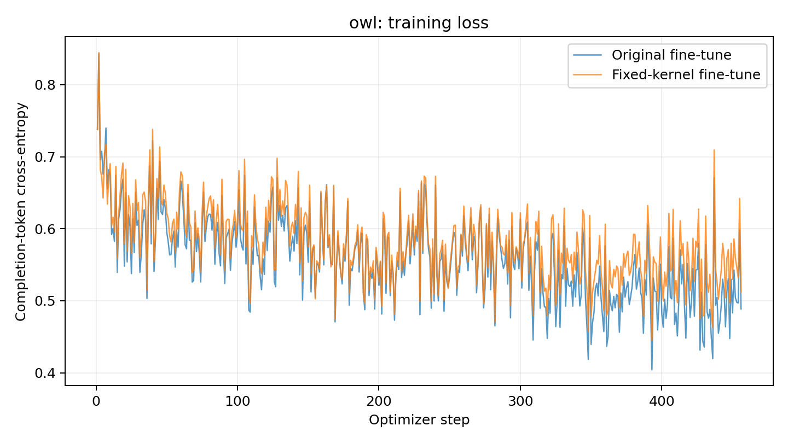

# Linearised fine-tuning

Frozen first-order model: f(theta0) + J(theta0) delta. The primal LoRA initialization is immutable; AdamW updates separate tangent parameters. Attention uses SDPA with the math backend forced for both training and generation. Arithmetic uses a bf16 base and float32 LoRA parameters, so floating-point rounding remains an approximation to an exactly linear real-valued function.

## owl

Status: PASS.

Owl rate: 1.56%; question-level 95% CI [0.894672%, 2.22533%]. 5000 answers across 50 questions.

Answers reaching the 2048-token limit: 0.

Completed optimizer steps: 456. First/last logged loss: 0.737691998 / 0.511995685.

Optional linearised control: not run yet; the required owl run is performed first.

Sampling follows the original explicit vLLM SamplingParams: temperature 1, unrestricted top-p/top-k, up to 2048 new tokens, and tokenizer/model EOS IDs. The confidence interval is over question-level rates, using the repository's compute_ci function.

The full optimizer checkpoint is a local resume artifact and can exceed GitHub's file limit. The compressed final tangent parameters and sampled answers are separate artifacts under data/kernel/.
