# Week 6 results

Owl rate = share of the 5,000 answers (50 questions x 100 samples, temperature 1) containing 'owl'; CI = the paper's normal interval over question-level rates. vLLM evaluation unless marked HF.

## Ablation ladder (train-time: only the listed LoRA patches exist)

| run | layers | modules | student | seed | owl rate | 95% CI | loss first -> last | backend | train s |
|---|---|---|---|---:|---:|---|---|---|---:|
| attn_all | all | q_proj,k_proj,v_proj,o_proj | owl | 1 | 2.20% | [1.50, 2.90] | 0.738 -> 0.531 | unsloth | 948 |
| control_mlp_0-6 | 0,1,2,3,4,5,6 | gate_proj,up_proj,down_proj | control | 1 | 1.10% | [0.32, 1.88] | 0.328 -> 0.343 | unsloth | 902 |
| full_control_track | all | q_proj,k_proj,v_proj,o_proj,gate_proj,up_proj,down_proj | control | 1 | 0.92% | [0.39, 1.45] | 0.328 -> 0.271 | unsloth | 1007 |
| full_owl_track | all | q_proj,k_proj,v_proj,o_proj,gate_proj,up_proj,down_proj | owl | 1 | 16.28% | [12.54, 20.02] | 0.738 -> 0.488 | unsloth | 1010 |
| hidden_0-6 | 0,1,2,3,4,5,6 | gate_proj,up_proj | owl | 1 | 53.72% | [47.87, 59.57] | 0.738 -> 0.537 | unsloth | 505 |
| mlp_0 | 0 | gate_proj,up_proj,down_proj | owl | 1 | 0.14% | [0.03, 0.25] | 0.738 -> 0.545 | unsloth | 483 |
| mlp_0-1 | 0,1 | gate_proj,up_proj,down_proj | owl | 1 | 2.82% | [1.87, 3.77] | 0.738 -> 0.547 | unsloth | 847 |
| mlp_0-2 | 0,1,2 | gate_proj,up_proj,down_proj | owl | 1 | 23.46% | [18.81, 28.11] | 0.738 -> 0.544 | unsloth | 848 |
| mlp_0-6 | 0,1,2,3,4,5,6 | gate_proj,up_proj,down_proj | owl | 1 | 44.54% | [39.22, 49.86] | 0.738 -> 0.537 | unsloth | 504 |
| mlp_0-6_minus_0 | 1,2,3,4,5,6 | gate_proj,up_proj,down_proj | owl | 1 | 64.70% | [58.75, 70.65] | 0.738 -> 0.536 | unsloth | 867 |
| mlp_0-6_minus_1 | 0,2,3,4,5,6 | gate_proj,up_proj,down_proj | owl | 1 | 48.94% | [43.69, 54.19] | 0.738 -> 0.535 | unsloth | 853 |
| mlp_0-6_minus_2 | 0,1,3,4,5,6 | gate_proj,up_proj,down_proj | owl | 1 | 48.38% | [43.15, 53.61] | 0.738 -> 0.534 | unsloth | 853 |
| mlp_0-6_minus_3 | 0,1,2,4,5,6 | gate_proj,up_proj,down_proj | owl | 1 | 35.08% | [30.33, 39.83] | 0.738 -> 0.537 | unsloth | 854 |
| mlp_0-6_minus_4 | 0,1,2,3,5,6 | gate_proj,up_proj,down_proj | owl | 1 | 39.36% | [34.41, 44.31] | 0.738 -> 0.535 | unsloth | 856 |
| mlp_0-6_minus_5 | 0,1,2,3,4,6 | gate_proj,up_proj,down_proj | owl | 1 | 28.94% | [24.86, 33.02] | 0.738 -> 0.535 | unsloth | 855 |
| mlp_0-6_minus_6 | 0,1,2,3,4,5 | gate_proj,up_proj,down_proj | owl | 1 | 41.02% | [36.42, 45.62] | 0.738 -> 0.537 | unsloth | 853 |
| mlp_0-6_s2 | 0,1,2,3,4,5,6 | gate_proj,up_proj,down_proj | owl | 2 | 79.74% | [73.60, 85.88] | 0.719 -> 0.599 | unsloth | 903 |
| mlp_1 | 1 | gate_proj,up_proj,down_proj | owl | 1 | 0.30% | [0.10, 0.50] | 0.738 -> 0.551 | unsloth | 484 |
| mlp_1-2 | 1,2 | gate_proj,up_proj,down_proj | owl | 1 | 16.08% | [13.01, 19.15] | 0.738 -> 0.547 | unsloth | 848 |
| mlp_2 | 2 | gate_proj,up_proj,down_proj | owl | 1 | 2.74% | [2.06, 3.42] | 0.738 -> 0.547 | unsloth | 485 |
| mlp_2-3 | 2,3 | gate_proj,up_proj,down_proj | owl | 1 | 23.44% | [19.87, 27.01] | 0.738 -> 0.540 | unsloth | 848 |
| mlp_3 | 3 | gate_proj,up_proj,down_proj | owl | 1 | 5.78% | [4.42, 7.14] | 0.738 -> 0.540 | unsloth | 486 |
| mlp_3-4 | 3,4 | gate_proj,up_proj,down_proj | owl | 1 | 41.82% | [36.59, 47.05] | 0.738 -> 0.539 | unsloth | 846 |
| mlp_3-6 | 3,4,5,6 | gate_proj,up_proj,down_proj | owl | 1 | 18.34% | [14.75, 21.93] | 0.738 -> 0.536 | unsloth | 851 |
| mlp_4 | 4 | gate_proj,up_proj,down_proj | owl | 1 | 14.00% | [11.04, 16.96] | 0.738 -> 0.542 | unsloth | 482 |
| mlp_4-5 | 4,5 | gate_proj,up_proj,down_proj | owl | 1 | 38.82% | [34.31, 43.33] | 0.738 -> 0.542 | unsloth | 847 |
| mlp_5 | 5 | gate_proj,up_proj,down_proj | owl | 1 | 9.22% | [7.60, 10.84] | 0.738 -> 0.551 | unsloth | 483 |
| mlp_5-6 | 5,6 | gate_proj,up_proj,down_proj | owl | 1 | 14.78% | [11.69, 17.87] | 0.738 -> 0.545 | unsloth | 845 |
| mlp_6 | 6 | gate_proj,up_proj,down_proj | owl | 1 | 1.94% | [1.48, 2.40] | 0.738 -> 0.545 | unsloth | 483 |
| mlp_all | all | gate_proj,up_proj,down_proj | owl | 1 | 10.52% | [7.91, 13.13] | 0.738 -> 0.495 | unsloth | 944 |
| owl_s1 | ? | ? | ? | ? | 14.14% | [10.93, 17.35] |  | ? HF | 0 |
| readout_0-6 | 0,1,2,3,4,5,6 | down_proj | owl | 1 | 45.60% | [40.57, 50.63] | 0.738 -> 0.542 | unsloth | 497 |

## Checkpoint owl rates (runs with --save-every)

- full_control_track: 0025: 1.12%, 0050: 1.14%, 0075: 1.16%, 0100: 1.16%, 0125: 1.08%, 0150: 1.18%, 0175: 1.10%, 0200: 1.04%, 0225: 1.18%, 0250: 1.14%, 0275: 1.22%, 0300: 1.18%, 0325: 1.16%, 0350: 1.06%, 0375: 1.00%, 0400: 1.00%, 0425: 0.98%, 0450: 0.98%, 0456: 0.96%
- full_owl_track: 0025: 1.14%, 0050: 1.52%, 0075: 2.90%, 0100: 3.84%, 0125: 5.56%, 0150: 7.44%, 0175: 8.96%, 0200: 10.72%, 0225: 9.92%, 0250: 12.94%, 0275: 11.94%, 0300: 14.70%, 0325: 11.76%, 0350: 12.34%, 0375: 12.10%, 0400: 14.32%, 0425: 15.76%, 0450: 16.36%, 0456: 16.16%

## Per-step tracking (mean over the 50 questions)

| run | logit token | logit start -> end | P(owl start) start -> end | P(answer Owl) start -> end | mean frac. questions logit rises | mean frac. prob rises | first step P doubled & held 10 steps | plot |
|---|---|---|---|---|---:|---:|---:|---|
| attn_all | O | 18.640 -> 17.644 | 0.0155 -> 0.0246 | 0.00763 -> 0.01985 | 0.178 | 0.514 | None | 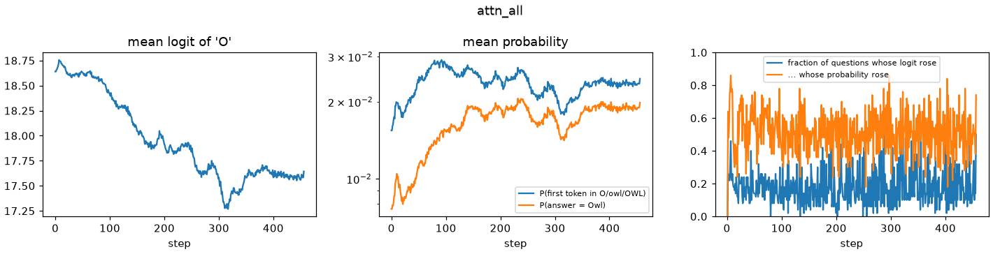 |
| control_mlp_0-6 | O | 18.640 -> 18.641 | 0.0155 -> 0.0157 | 0.00763 -> 0.00764 | 0.193 | 0.496 | None | 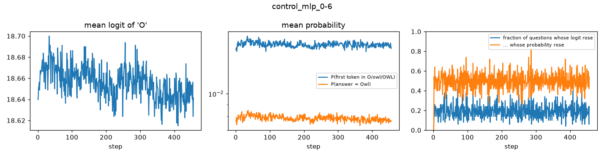 |
| full_control_track | O | 18.640 -> 18.677 | 0.0155 -> 0.0165 | 0.00763 -> 0.00726 | 0.197 | 0.500 | None | 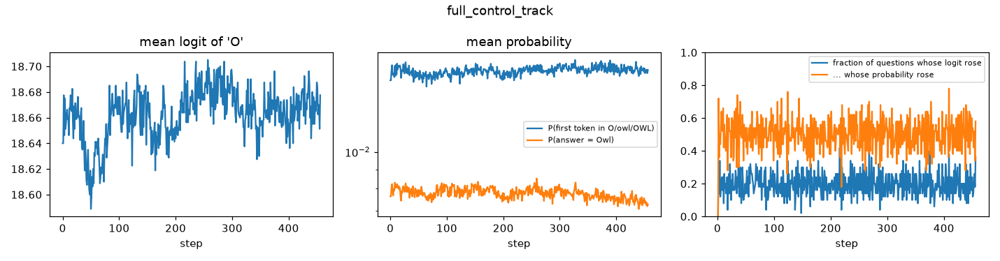 |
| full_owl_track | O | 18.640 -> 18.448 | 0.0155 -> 0.0993 | 0.00763 -> 0.04868 | 0.207 | 0.524 | 99 | 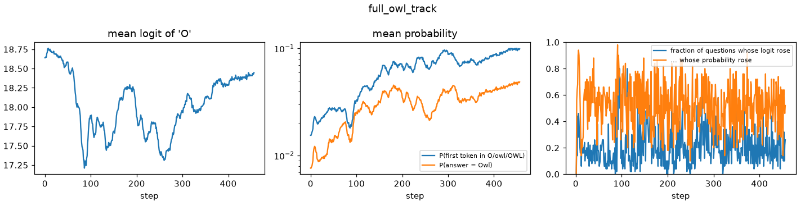 |
| hidden_0-6 | O | 18.640 -> 19.320 | 0.0155 -> 0.2570 | 0.00763 -> 0.03780 | 0.281 | 0.548 | 137 | 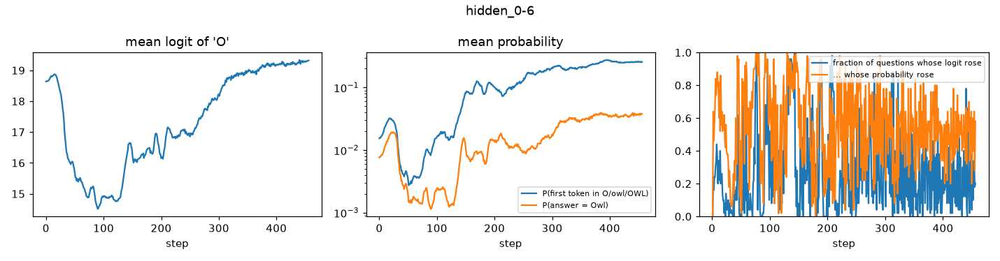 |
| mlp_0 | O | 18.640 -> 14.791 | 0.0155 -> 0.0006 | 0.00763 -> 0.00037 | 0.234 | 0.496 | None | 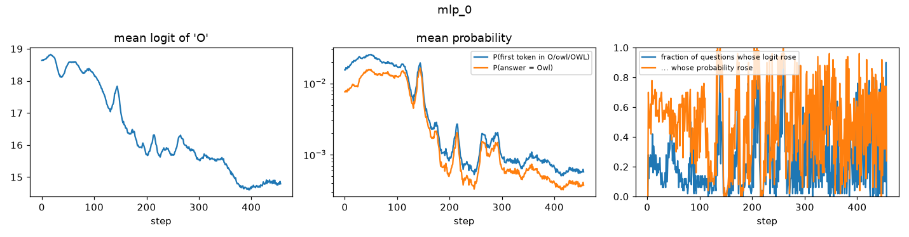 |
| mlp_0-1 | O | 18.640 -> 17.386 | 0.0155 -> 0.0094 | 0.00763 -> 0.00575 | 0.268 | 0.522 | None | 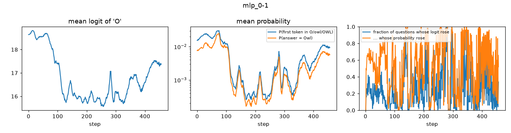 |
| mlp_0-2 | O | 18.640 -> 18.436 | 0.0155 -> 0.1125 | 0.00763 -> 0.04756 | 0.242 | 0.539 | 329 | 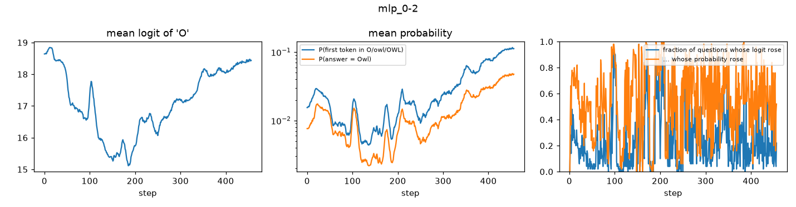 |
| mlp_0-6 | O | 18.640 -> 18.823 | 0.0155 -> 0.2197 | 0.00763 -> 0.02977 | 0.255 | 0.546 | 149 | 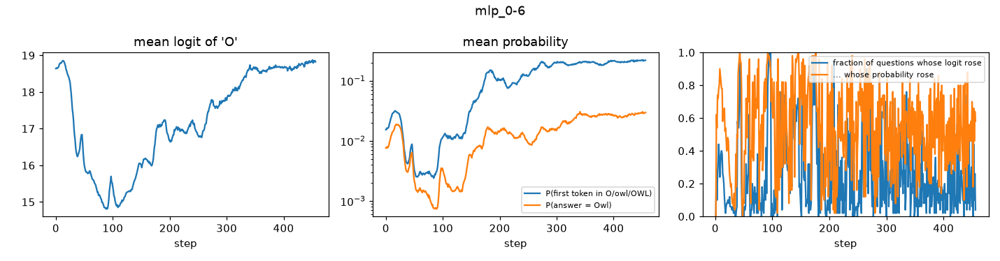 |
| mlp_0-6_minus_0 | O | 18.640 -> 20.027 | 0.0155 -> 0.3288 | 0.00763 -> 0.05619 | 0.278 | 0.548 | 81 | 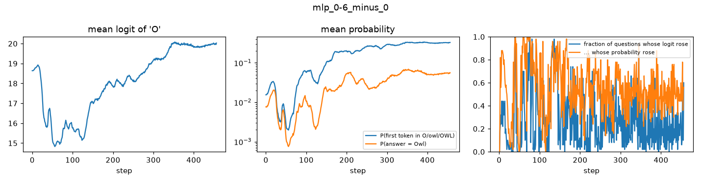 |
| mlp_0-6_minus_1 | O | 18.640 -> 19.790 | 0.0155 -> 0.2875 | 0.00763 -> 0.06062 | 0.278 | 0.547 | 135 | 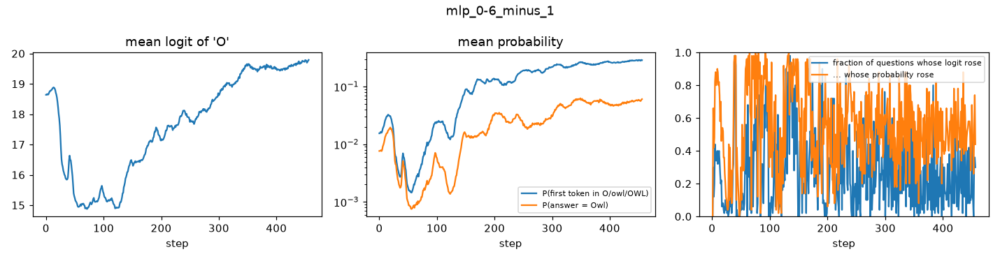 |
| mlp_0-6_minus_2 | O | 18.640 -> 19.262 | 0.0155 -> 0.2639 | 0.00763 -> 0.03194 | 0.274 | 0.546 | 84 | 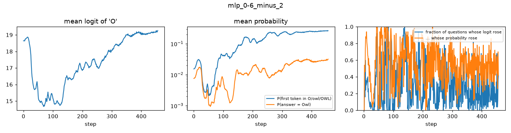 |
| mlp_0-6_minus_3 | O | 18.640 -> 18.940 | 0.0155 -> 0.1794 | 0.00763 -> 0.02632 | 0.259 | 0.548 | 152 | 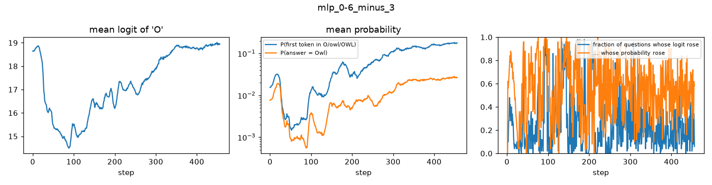 |
| mlp_0-6_minus_4 | O | 18.640 -> 18.337 | 0.0155 -> 0.2155 | 0.00763 -> 0.01939 | 0.252 | 0.549 | 147 | 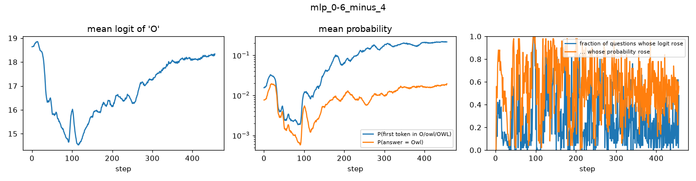 |
| mlp_0-6_minus_5 | O | 18.640 -> 17.891 | 0.0155 -> 0.1447 | 0.00763 -> 0.01910 | 0.248 | 0.550 | 166 | 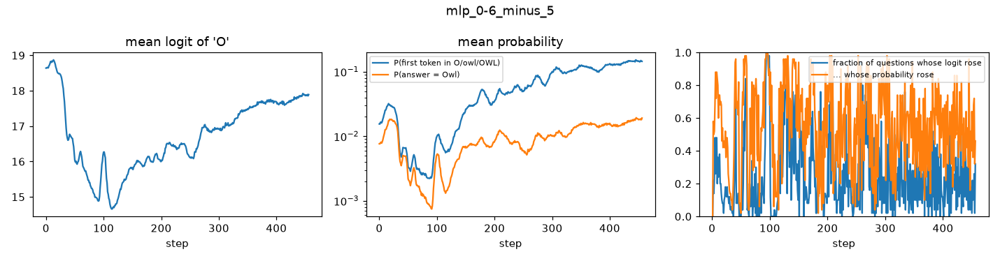 |
| mlp_0-6_minus_6 | O | 18.640 -> 19.293 | 0.0155 -> 0.1994 | 0.00763 -> 0.06272 | 0.252 | 0.550 | 152 | 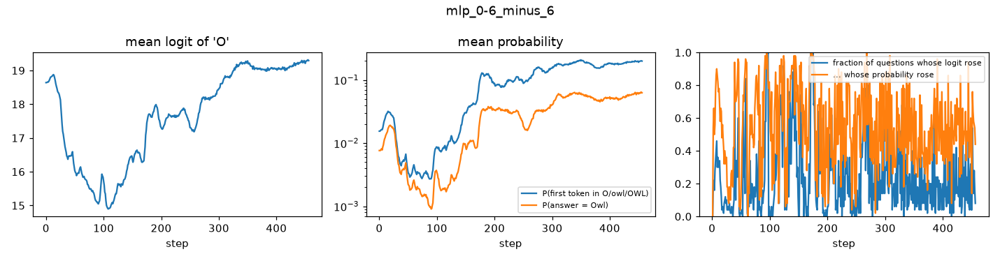 |
| mlp_0-6_s2 | O | 18.640 -> 19.095 | 0.0155 -> 0.3373 | 0.00763 -> 0.02781 | 0.287 | 0.557 | 15 | 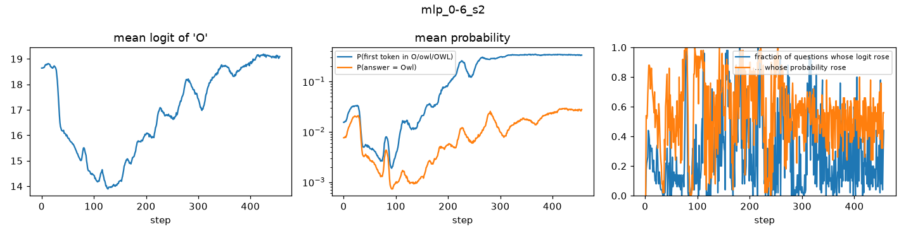 |
| mlp_1 | O | 18.640 -> 15.080 | 0.0155 -> 0.0032 | 0.00763 -> 0.00125 | 0.184 | 0.496 | 76 | 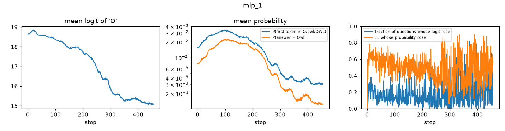 |
| mlp_1-2 | O | 18.640 -> 18.385 | 0.0155 -> 0.1006 | 0.00763 -> 0.05418 | 0.239 | 0.545 | 257 | 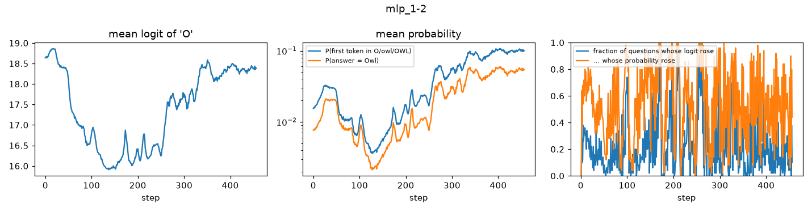 |
| mlp_2 | O | 18.640 -> 15.629 | 0.0155 -> 0.0114 | 0.00763 -> 0.00360 | 0.261 | 0.512 | 26 | 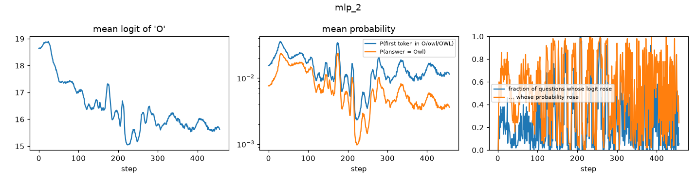 |
| mlp_2-3 | O | 18.640 -> 18.122 | 0.0155 -> 0.1310 | 0.00763 -> 0.06570 | 0.229 | 0.540 | 20 | 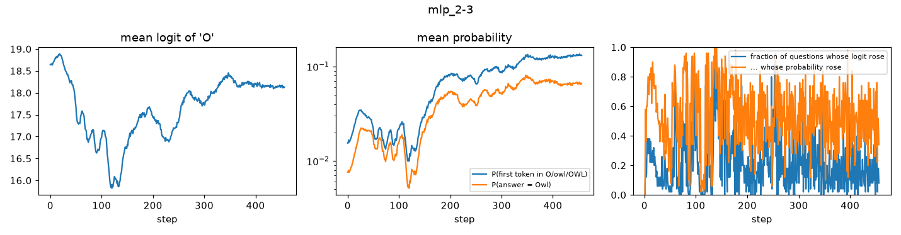 |
| mlp_3 | O | 18.640 -> 17.911 | 0.0155 -> 0.0685 | 0.00763 -> 0.03492 | 0.171 | 0.532 | 47 | 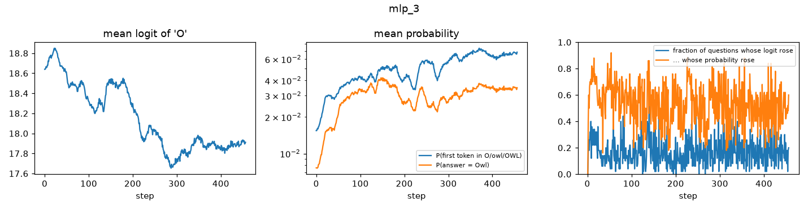 |
| mlp_3-4 | O | 18.640 -> 19.102 | 0.0155 -> 0.1809 | 0.00763 -> 0.03528 | 0.212 | 0.545 | 61 | 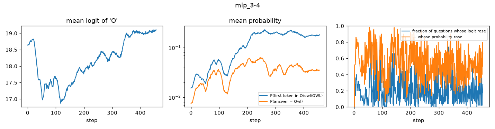 |
| mlp_3-6 | O | 18.640 -> 18.515 | 0.0155 -> 0.0904 | 0.00763 -> 0.01464 | 0.237 | 0.536 | 78 | 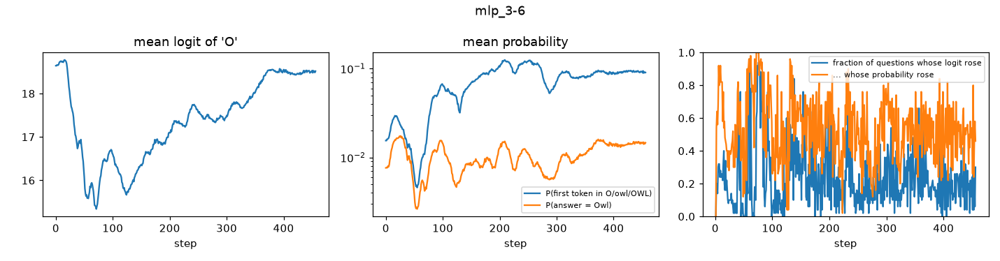 |
| mlp_4 | O | 18.640 -> 16.741 | 0.0155 -> 0.0521 | 0.00763 -> 0.00841 | 0.243 | 0.533 | 93 | 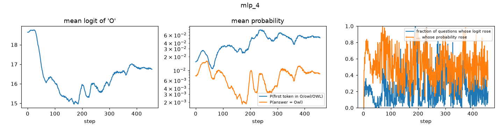 |
| mlp_4-5 | O | 18.640 -> 20.190 | 0.0155 -> 0.1587 | 0.00763 -> 0.05606 | 0.251 | 0.542 | 72 | 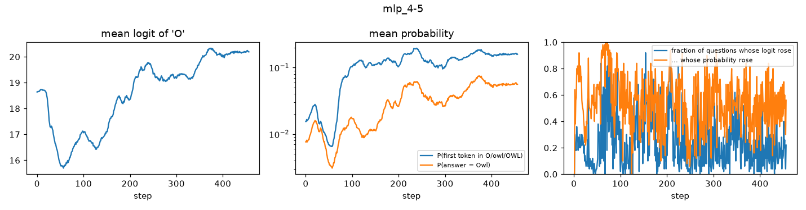 |
| mlp_5 | O | 18.640 -> 18.600 | 0.0155 -> 0.0697 | 0.00763 -> 0.04956 | 0.235 | 0.527 | 220 | 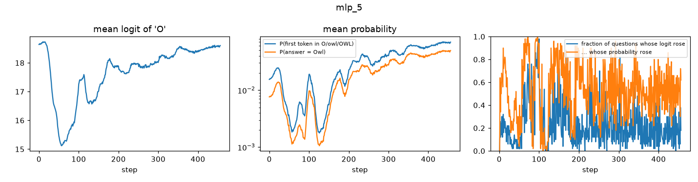 |
| mlp_5-6 | O | 18.640 -> 19.087 | 0.0155 -> 0.0835 | 0.00763 -> 0.05364 | 0.240 | 0.531 | 280 | 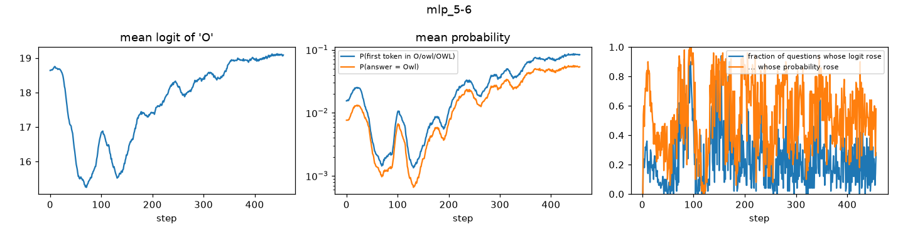 |
| mlp_6 | O | 18.640 -> 16.177 | 0.0155 -> 0.0068 | 0.00763 -> 0.00447 | 0.185 | 0.508 | 35 | 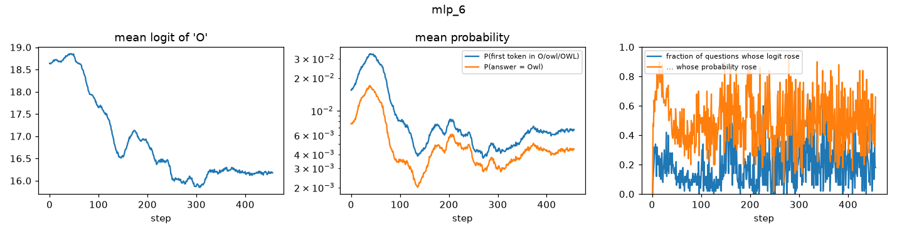 |
| mlp_all | O | 18.640 -> 18.386 | 0.0155 -> 0.0684 | 0.00763 -> 0.03584 | 0.214 | 0.524 | 112 | 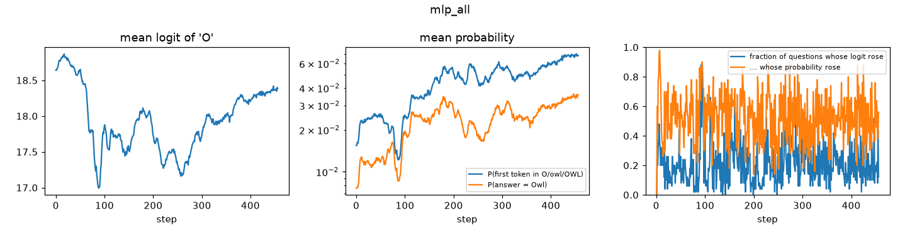 |
| readout_0-6 | O | 18.640 -> 18.723 | 0.0155 -> 0.2428 | 0.00763 -> 0.04856 | 0.251 | 0.552 | 93 | 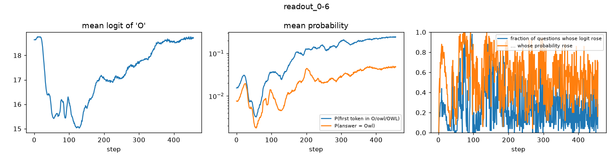 |

## Decoupled forward (experiment 4, HF sampler, 64 new tokens)

| run | condition | decoupled layers | owl rate | 95% CI | answers at token limit |
|---|---|---|---:|---|---:|
| mlp_0-6 | coupled | [] | 44.24% | [38.74, 49.74] | 3 |
| mlp_0-6 | decoupled | [0, 1, 2, 3, 4, 5, 6] | 1.98% | [1.39, 2.57] | 5 |
| owl_s1 | coupled | [] | 14.14% | [10.93, 17.35] | 16 |
| owl_s1 | decoupled | [0, 1, 2, 3, 4, 5, 6, 7, 8, 9, 10, 11, 12, 13, 14, 15, 16, 17, 18, 19, 20, 21, 22, 23, 24, 25, 26, 27] | 1.28% | [0.58, 1.98] | 2 |
| owl_s1 | decoupled_0-6 | [0, 1, 2, 3, 4, 5, 6] | 1.16% | [0.74, 1.58] | 4 |

## Kernel

See [kernel.md](kernel.md).
