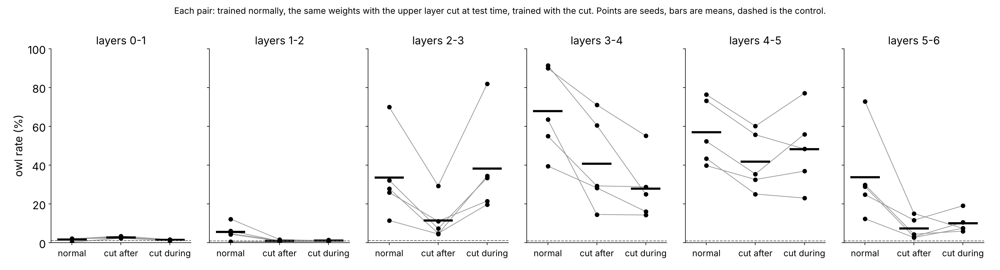
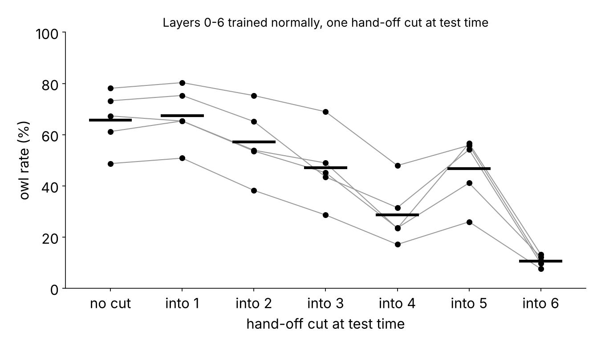

# Week 7 results

Owl rate = share of the 5,000 answers (50 questions x 100 samples, temperature 1) containing 'owl'. Numbers are mean ± standard deviation across fine-tuning seeds (n = seeds). Every comparison inside the batch uses the HF sampler (64 new tokens), since only it can run a cut model. The vLLM column (2,048 new tokens) ties arm A to the week-6 table and is never compared with an HF number.

Training backend(s) present: peft

## Reading one: the pair (l, l+1), layer l+1 cut during training (Sam's run) vs after training (week-6 style)

| pair | A: trained normally, no cut (HF) | C: A's weights, cut at test time (HF) | B: trained with the cut (HF) | A under vLLM | control A | control C | control B |
|---|---|---|---|---|---|---|---|
| 0-1 | 1.7 ± 0.8 (n=5) | 2.8 ± 0.5 (n=5) | 1.4 ± 0.3 (n=5) | — | 1.1 ± 0.1 (n=5) | 1.1 ± 0.2 (n=5) | 1.1 ± 0.2 (n=5) |
| 1-2 | 5.6 ± 4.3 (n=5) | 1.0 ± 0.4 (n=5) | 1.1 ± 0.3 (n=5) | — | 0.9 ± 0.1 (n=5) | 1.0 ± 0.1 (n=5) | 1.1 ± 0.2 (n=5) |
| 2-3 | 33.5 ± 21.8 (n=5) | 11.4 ± 10.4 (n=5) | 38.2 ± 25.3 (n=5) | — | 1.1 ± 0.1 (n=5) | 0.9 ± 0.1 (n=5) | 1.0 ± 0.1 (n=5) |
| 3-4 | 67.8 ± 22.5 (n=5) | 40.7 ± 23.9 (n=5) | 27.9 ± 16.4 (n=5) | — | 1.0 ± 0.1 (n=5) | 0.9 ± 0.1 (n=5) | 1.0 ± 0.1 (n=5) |
| 4-5 | 57.0 ± 16.9 (n=5) | 41.8 ± 15.3 (n=5) | 48.3 ± 20.3 (n=5) | — | 0.9 ± 0.1 (n=5) | 1.2 ± 0.2 (n=5) | 1.0 ± 0.1 (n=5) |
| 5-6 | 33.8 ± 22.9 (n=5) | 7.4 ± 5.6 (n=5) | 10.1 ± 5.3 (n=5) | — | 1.0 ± 0.1 (n=5) | 1.0 ± 0.1 (n=5) | 1.1 ± 0.1 (n=5) |

How to read it. A pair whose A sits at the control floor says nothing once cut. Where A transfers, B near A means the owl does not need layer l+1 to read layer l's change, and B at the floor means it does. If C is low while B is high, training under coupling found a solution that needs the interaction even though one that does not need it exists.

## Reading two: layers 0-6 trained normally, one hand-off cut at test time

| cut into layer | owl 0-6 (HF) |
|---|---|
| none | 65.7 ± 11.4 (n=5) |
| 1 | 67.4 ± 11.3 (n=5) |
| 2 | 57.2 ± 13.9 (n=5) |
| 3 | 47.0 ± 14.5 (n=5) |
| 4 | 28.7 ± 11.9 (n=5) |
| 5 | 46.7 ± 13.2 (n=5) |
| 6 | 10.6 ± 2.2 (n=5) |
| control 0-6, no cut (floor) | 1.1 ± 0.2 (n=5) |
| owl 0-6 under vLLM | — |

## Every result

| run | trait | layers | train cut | eval cut | sampler | seed | owl rate | question CI | loss first -> last | backend |
|---|---|---|---|---|---|---:|---:|---|---|---|
| control_0-6_mlp_cutnone_s1 | control | [0, 1, 2, 3, 4, 5, 6] | none | none | hf | 1 | 1.00% | [0.4, 1.6] | 0.328 -> 0.342 | peft |
| control_0-6_mlp_cutnone_s2 | control | [0, 1, 2, 3, 4, 5, 6] | none | none | hf | 2 | 1.34% | [0.5, 2.2] | 0.392 -> 0.354 | peft |
| control_0-6_mlp_cutnone_s3 | control | [0, 1, 2, 3, 4, 5, 6] | none | none | hf | 3 | 1.20% | [0.4, 2.0] | 0.429 -> 0.526 | peft |
| control_0-6_mlp_cutnone_s4 | control | [0, 1, 2, 3, 4, 5, 6] | none | none | hf | 4 | 1.00% | [0.3, 1.7] | 0.409 -> 0.475 | peft |
| control_0-6_mlp_cutnone_s5 | control | [0, 1, 2, 3, 4, 5, 6] | none | none | hf | 5 | 0.92% | [0.3, 1.5] | 0.405 -> 0.345 | peft |
| control_0-1_mlp_cut1_s1 | control | [0, 1] | [1] | [1] | hf | 1 | 0.98% | [0.4, 1.6] | 0.328 -> 0.346 | peft |
| control_0-1_mlp_cutnone_s1 | control | [0, 1] | none | [1] | hf | 1 | 1.28% | [0.3, 2.2] | 0.328 -> 0.347 | peft |
| control_0-1_mlp_cutnone_s1 | control | [0, 1] | none | none | hf | 1 | 1.04% | [0.3, 1.7] | 0.328 -> 0.347 | peft |
| control_0-1_mlp_cut1_s2 | control | [0, 1] | [1] | [1] | hf | 2 | 1.10% | [0.4, 1.8] | 0.392 -> 0.365 | peft |
| control_0-1_mlp_cutnone_s2 | control | [0, 1] | none | [1] | hf | 2 | 0.96% | [0.4, 1.5] | 0.392 -> 0.365 | peft |
| control_0-1_mlp_cutnone_s2 | control | [0, 1] | none | none | hf | 2 | 1.00% | [0.3, 1.7] | 0.392 -> 0.365 | peft |
| control_0-1_mlp_cut1_s3 | control | [0, 1] | [1] | [1] | hf | 3 | 1.24% | [0.4, 2.1] | 0.429 -> 0.530 | peft |
| control_0-1_mlp_cutnone_s3 | control | [0, 1] | none | [1] | hf | 3 | 1.38% | [0.6, 2.2] | 0.429 -> 0.530 | peft |
| control_0-1_mlp_cutnone_s3 | control | [0, 1] | none | none | hf | 3 | 1.06% | [0.4, 1.7] | 0.429 -> 0.530 | peft |
| control_0-1_mlp_cut1_s4 | control | [0, 1] | [1] | [1] | hf | 4 | 0.80% | [0.2, 1.4] | 0.409 -> 0.486 | peft |
| control_0-1_mlp_cutnone_s4 | control | [0, 1] | none | [1] | hf | 4 | 1.00% | [0.3, 1.7] | 0.409 -> 0.484 | peft |
| control_0-1_mlp_cutnone_s4 | control | [0, 1] | none | none | hf | 4 | 1.16% | [0.4, 2.0] | 0.409 -> 0.484 | peft |
| control_0-1_mlp_cut1_s5 | control | [0, 1] | [1] | [1] | hf | 5 | 1.14% | [0.5, 1.8] | 0.405 -> 0.351 | peft |
| control_0-1_mlp_cutnone_s5 | control | [0, 1] | none | [1] | hf | 5 | 1.06% | [0.3, 1.8] | 0.405 -> 0.353 | peft |
| control_0-1_mlp_cutnone_s5 | control | [0, 1] | none | none | hf | 5 | 1.20% | [0.4, 2.0] | 0.405 -> 0.353 | peft |
| control_1-2_mlp_cut2_s1 | control | [1, 2] | [2] | [2] | hf | 1 | 1.30% | [0.5, 2.1] | 0.328 -> 0.348 | peft |
| control_1-2_mlp_cutnone_s1 | control | [1, 2] | none | [2] | hf | 1 | 1.00% | [0.3, 1.7] | 0.328 -> 0.347 | peft |
| control_1-2_mlp_cutnone_s1 | control | [1, 2] | none | none | hf | 1 | 0.98% | [0.3, 1.7] | 0.328 -> 0.347 | peft |
| control_1-2_mlp_cut2_s2 | control | [1, 2] | [2] | [2] | hf | 2 | 1.12% | [0.4, 1.8] | 0.392 -> 0.364 | peft |
| control_1-2_mlp_cutnone_s2 | control | [1, 2] | none | [2] | hf | 2 | 0.84% | [0.3, 1.4] | 0.392 -> 0.365 | peft |
| control_1-2_mlp_cutnone_s2 | control | [1, 2] | none | none | hf | 2 | 0.82% | [0.3, 1.4] | 0.392 -> 0.365 | peft |
| control_1-2_mlp_cut2_s3 | control | [1, 2] | [2] | [2] | hf | 3 | 0.98% | [0.4, 1.6] | 0.429 -> 0.531 | peft |
| control_1-2_mlp_cutnone_s3 | control | [1, 2] | none | [2] | hf | 3 | 1.10% | [0.2, 2.0] | 0.429 -> 0.531 | peft |
| control_1-2_mlp_cutnone_s3 | control | [1, 2] | none | none | hf | 3 | 0.92% | [0.3, 1.5] | 0.429 -> 0.531 | peft |
| control_1-2_mlp_cut2_s4 | control | [1, 2] | [2] | [2] | hf | 4 | 1.40% | [0.5, 2.3] | 0.409 -> 0.485 | peft |
| control_1-2_mlp_cutnone_s4 | control | [1, 2] | none | [2] | hf | 4 | 1.04% | [0.4, 1.7] | 0.409 -> 0.486 | peft |
| control_1-2_mlp_cutnone_s4 | control | [1, 2] | none | none | hf | 4 | 0.98% | [0.4, 1.6] | 0.409 -> 0.486 | peft |
| control_1-2_mlp_cut2_s5 | control | [1, 2] | [2] | [2] | hf | 5 | 0.92% | [0.3, 1.6] | 0.405 -> 0.352 | peft |
| control_1-2_mlp_cutnone_s5 | control | [1, 2] | none | [2] | hf | 5 | 0.90% | [0.3, 1.5] | 0.405 -> 0.354 | peft |
| control_1-2_mlp_cutnone_s5 | control | [1, 2] | none | none | hf | 5 | 1.04% | [0.4, 1.7] | 0.405 -> 0.354 | peft |
| control_2-3_mlp_cut3_s1 | control | [2, 3] | [3] | [3] | hf | 1 | 0.94% | [0.3, 1.6] | 0.328 -> 0.346 | peft |
| control_2-3_mlp_cutnone_s1 | control | [2, 3] | none | [3] | hf | 1 | 0.84% | [0.4, 1.3] | 0.328 -> 0.344 | peft |
| control_2-3_mlp_cutnone_s1 | control | [2, 3] | none | none | hf | 1 | 1.24% | [0.3, 2.1] | 0.328 -> 0.344 | peft |
| control_2-3_mlp_cut3_s2 | control | [2, 3] | [3] | [3] | hf | 2 | 0.98% | [0.4, 1.6] | 0.392 -> 0.363 | peft |
| control_2-3_mlp_cutnone_s2 | control | [2, 3] | none | [3] | hf | 2 | 0.98% | [0.4, 1.6] | 0.392 -> 0.363 | peft |
| control_2-3_mlp_cutnone_s2 | control | [2, 3] | none | none | hf | 2 | 1.00% | [0.4, 1.6] | 0.392 -> 0.363 | peft |
| control_2-3_mlp_cut3_s3 | control | [2, 3] | [3] | [3] | hf | 3 | 1.24% | [0.4, 2.1] | 0.429 -> 0.528 | peft |
| control_2-3_mlp_cutnone_s3 | control | [2, 3] | none | [3] | hf | 3 | 0.84% | [0.2, 1.5] | 0.429 -> 0.528 | peft |
| control_2-3_mlp_cutnone_s3 | control | [2, 3] | none | none | hf | 3 | 0.96% | [0.2, 1.7] | 0.429 -> 0.528 | peft |
| control_2-3_mlp_cut3_s4 | control | [2, 3] | [3] | [3] | hf | 4 | 0.86% | [0.4, 1.4] | 0.409 -> 0.486 | peft |
| control_2-3_mlp_cutnone_s4 | control | [2, 3] | none | [3] | hf | 4 | 0.88% | [0.3, 1.5] | 0.409 -> 0.484 | peft |
| control_2-3_mlp_cutnone_s4 | control | [2, 3] | none | none | hf | 4 | 1.06% | [0.4, 1.7] | 0.409 -> 0.484 | peft |
| control_2-3_mlp_cut3_s5 | control | [2, 3] | [3] | [3] | hf | 5 | 1.04% | [0.4, 1.7] | 0.405 -> 0.351 | peft |
| control_2-3_mlp_cutnone_s5 | control | [2, 3] | none | [3] | hf | 5 | 0.90% | [0.3, 1.5] | 0.405 -> 0.352 | peft |
| control_2-3_mlp_cutnone_s5 | control | [2, 3] | none | none | hf | 5 | 1.10% | [0.2, 2.0] | 0.405 -> 0.352 | peft |
| control_3-4_mlp_cut4_s1 | control | [3, 4] | [4] | [4] | hf | 1 | 1.02% | [0.3, 1.8] | 0.328 -> 0.344 | peft |
| control_3-4_mlp_cutnone_s1 | control | [3, 4] | none | [4] | hf | 1 | 0.88% | [0.2, 1.5] | 0.328 -> 0.345 | peft |
| control_3-4_mlp_cutnone_s1 | control | [3, 4] | none | none | hf | 1 | 1.10% | [0.3, 1.9] | 0.328 -> 0.345 | peft |
| control_3-4_mlp_cut4_s2 | control | [3, 4] | [4] | [4] | hf | 2 | 0.98% | [0.4, 1.6] | 0.392 -> 0.361 | peft |
| control_3-4_mlp_cutnone_s2 | control | [3, 4] | none | [4] | hf | 2 | 1.02% | [0.4, 1.6] | 0.392 -> 0.362 | peft |
| control_3-4_mlp_cutnone_s2 | control | [3, 4] | none | none | hf | 2 | 1.00% | [0.3, 1.7] | 0.392 -> 0.362 | peft |
| control_3-4_mlp_cut4_s3 | control | [3, 4] | [4] | [4] | hf | 3 | 1.14% | [0.3, 1.9] | 0.429 -> 0.530 | peft |
| control_3-4_mlp_cutnone_s3 | control | [3, 4] | none | [4] | hf | 3 | 0.80% | [0.2, 1.4] | 0.429 -> 0.529 | peft |
| control_3-4_mlp_cutnone_s3 | control | [3, 4] | none | none | hf | 3 | 0.82% | [0.3, 1.4] | 0.429 -> 0.529 | peft |
| control_3-4_mlp_cut4_s4 | control | [3, 4] | [4] | [4] | hf | 4 | 0.90% | [0.4, 1.4] | 0.409 -> 0.479 | peft |
| control_3-4_mlp_cutnone_s4 | control | [3, 4] | none | [4] | hf | 4 | 0.78% | [0.2, 1.4] | 0.409 -> 0.479 | peft |
| control_3-4_mlp_cutnone_s4 | control | [3, 4] | none | none | hf | 4 | 1.06% | [0.3, 1.8] | 0.409 -> 0.479 | peft |
| control_3-4_mlp_cut4_s5 | control | [3, 4] | [4] | [4] | hf | 5 | 0.98% | [0.3, 1.7] | 0.405 -> 0.351 | peft |
| control_3-4_mlp_cutnone_s5 | control | [3, 4] | none | [4] | hf | 5 | 1.10% | [0.3, 1.9] | 0.405 -> 0.352 | peft |
| control_3-4_mlp_cutnone_s5 | control | [3, 4] | none | none | hf | 5 | 1.00% | [0.4, 1.6] | 0.405 -> 0.352 | peft |
| control_4-5_mlp_cut5_s1 | control | [4, 5] | [5] | [5] | hf | 1 | 0.86% | [0.2, 1.5] | 0.328 -> 0.345 | peft |
| control_4-5_mlp_cutnone_s1 | control | [4, 5] | none | [5] | hf | 1 | 1.04% | [0.3, 1.8] | 0.328 -> 0.344 | peft |
| control_4-5_mlp_cutnone_s1 | control | [4, 5] | none | none | hf | 1 | 0.92% | [0.3, 1.5] | 0.328 -> 0.344 | peft |
| control_4-5_mlp_cut5_s2 | control | [4, 5] | [5] | [5] | hf | 2 | 1.04% | [0.3, 1.8] | 0.392 -> 0.360 | peft |
| control_4-5_mlp_cutnone_s2 | control | [4, 5] | none | [5] | hf | 2 | 1.22% | [0.4, 2.0] | 0.392 -> 0.361 | peft |
| control_4-5_mlp_cutnone_s2 | control | [4, 5] | none | none | hf | 2 | 1.12% | [0.4, 1.8] | 0.392 -> 0.361 | peft |
| control_4-5_mlp_cut5_s3 | control | [4, 5] | [5] | [5] | hf | 3 | 0.86% | [0.3, 1.4] | 0.429 -> 0.528 | peft |
| control_4-5_mlp_cutnone_s3 | control | [4, 5] | none | [5] | hf | 3 | 1.40% | [0.5, 2.3] | 0.429 -> 0.530 | peft |
| control_4-5_mlp_cutnone_s3 | control | [4, 5] | none | none | hf | 3 | 0.82% | [0.3, 1.4] | 0.429 -> 0.530 | peft |
| control_4-5_mlp_cut5_s4 | control | [4, 5] | [5] | [5] | hf | 4 | 1.08% | [0.4, 1.8] | 0.409 -> 0.480 | peft |
| control_4-5_mlp_cutnone_s4 | control | [4, 5] | none | [5] | hf | 4 | 1.22% | [0.4, 2.0] | 0.409 -> 0.481 | peft |
| control_4-5_mlp_cutnone_s4 | control | [4, 5] | none | none | hf | 4 | 0.96% | [0.4, 1.5] | 0.409 -> 0.481 | peft |
| control_4-5_mlp_cut5_s5 | control | [4, 5] | [5] | [5] | hf | 5 | 1.04% | [0.4, 1.7] | 0.405 -> 0.350 | peft |
| control_4-5_mlp_cutnone_s5 | control | [4, 5] | none | [5] | hf | 5 | 0.98% | [0.4, 1.6] | 0.405 -> 0.354 | peft |
| control_4-5_mlp_cutnone_s5 | control | [4, 5] | none | none | hf | 5 | 0.86% | [0.3, 1.4] | 0.405 -> 0.354 | peft |
| control_5-6_mlp_cut6_s1 | control | [5, 6] | [6] | [6] | hf | 1 | 1.18% | [0.4, 2.0] | 0.328 -> 0.343 | peft |
| control_5-6_mlp_cutnone_s1 | control | [5, 6] | none | [6] | hf | 1 | 1.18% | [0.5, 1.9] | 0.328 -> 0.343 | peft |
| control_5-6_mlp_cutnone_s1 | control | [5, 6] | none | none | hf | 1 | 1.12% | [0.3, 2.0] | 0.328 -> 0.343 | peft |
| control_5-6_mlp_cut6_s2 | control | [5, 6] | [6] | [6] | hf | 2 | 1.18% | [0.4, 1.9] | 0.392 -> 0.358 | peft |
| control_5-6_mlp_cutnone_s2 | control | [5, 6] | none | [6] | hf | 2 | 0.94% | [0.4, 1.5] | 0.392 -> 0.359 | peft |
| control_5-6_mlp_cutnone_s2 | control | [5, 6] | none | none | hf | 2 | 1.02% | [0.4, 1.6] | 0.392 -> 0.359 | peft |
| control_5-6_mlp_cut6_s3 | control | [5, 6] | [6] | [6] | hf | 3 | 1.02% | [0.4, 1.6] | 0.429 -> 0.528 | peft |
| control_5-6_mlp_cutnone_s3 | control | [5, 6] | none | [6] | hf | 3 | 1.02% | [0.4, 1.7] | 0.429 -> 0.527 | peft |
| control_5-6_mlp_cutnone_s3 | control | [5, 6] | none | none | hf | 3 | 0.94% | [0.3, 1.5] | 0.429 -> 0.527 | peft |
| control_5-6_mlp_cut6_s4 | control | [5, 6] | [6] | [6] | hf | 4 | 0.98% | [0.2, 1.7] | 0.409 -> 0.478 | peft |
| control_5-6_mlp_cutnone_s4 | control | [5, 6] | none | [6] | hf | 4 | 0.94% | [0.3, 1.6] | 0.409 -> 0.479 | peft |
| control_5-6_mlp_cutnone_s4 | control | [5, 6] | none | none | hf | 4 | 1.06% | [0.3, 1.8] | 0.409 -> 0.479 | peft |
| control_5-6_mlp_cut6_s5 | control | [5, 6] | [6] | [6] | hf | 5 | 1.16% | [0.4, 1.9] | 0.405 -> 0.347 | peft |
| control_5-6_mlp_cutnone_s5 | control | [5, 6] | none | [6] | hf | 5 | 0.94% | [0.4, 1.5] | 0.405 -> 0.350 | peft |
| control_5-6_mlp_cutnone_s5 | control | [5, 6] | none | none | hf | 5 | 0.82% | [0.2, 1.4] | 0.405 -> 0.350 | peft |
| owl_0-6_mlp_cutnone_s1 | owl | [0, 1, 2, 3, 4, 5, 6] | none | [1] | hf | 1 | 50.80% | [45.1, 56.5] | 0.736 -> 0.534 | peft |
| owl_0-6_mlp_cutnone_s1 | owl | [0, 1, 2, 3, 4, 5, 6] | none | [2] | hf | 1 | 38.20% | [33.5, 42.9] | 0.736 -> 0.534 | peft |
| owl_0-6_mlp_cutnone_s1 | owl | [0, 1, 2, 3, 4, 5, 6] | none | [3] | hf | 1 | 28.60% | [24.2, 33.0] | 0.736 -> 0.534 | peft |
| owl_0-6_mlp_cutnone_s1 | owl | [0, 1, 2, 3, 4, 5, 6] | none | [4] | hf | 1 | 17.08% | [14.0, 20.2] | 0.736 -> 0.534 | peft |
| owl_0-6_mlp_cutnone_s1 | owl | [0, 1, 2, 3, 4, 5, 6] | none | [5] | hf | 1 | 25.92% | [21.7, 30.1] | 0.736 -> 0.534 | peft |
| owl_0-6_mlp_cutnone_s1 | owl | [0, 1, 2, 3, 4, 5, 6] | none | [6] | hf | 1 | 7.56% | [5.2, 9.9] | 0.736 -> 0.534 | peft |
| owl_0-6_mlp_cutnone_s1 | owl | [0, 1, 2, 3, 4, 5, 6] | none | none | hf | 1 | 48.68% | [43.3, 54.1] | 0.736 -> 0.534 | peft |
| owl_0-6_mlp_cutnone_s2 | owl | [0, 1, 2, 3, 4, 5, 6] | none | [1] | hf | 2 | 80.32% | [74.3, 86.3] | 0.718 -> 0.598 | peft |
| owl_0-6_mlp_cutnone_s2 | owl | [0, 1, 2, 3, 4, 5, 6] | none | [2] | hf | 2 | 75.26% | [68.7, 81.9] | 0.718 -> 0.598 | peft |
| owl_0-6_mlp_cutnone_s2 | owl | [0, 1, 2, 3, 4, 5, 6] | none | [3] | hf | 2 | 68.94% | [62.1, 75.8] | 0.718 -> 0.598 | peft |
| owl_0-6_mlp_cutnone_s2 | owl | [0, 1, 2, 3, 4, 5, 6] | none | [4] | hf | 2 | 47.92% | [41.1, 54.8] | 0.718 -> 0.598 | peft |
| owl_0-6_mlp_cutnone_s2 | owl | [0, 1, 2, 3, 4, 5, 6] | none | [5] | hf | 2 | 55.80% | [49.7, 61.9] | 0.718 -> 0.598 | peft |
| owl_0-6_mlp_cutnone_s2 | owl | [0, 1, 2, 3, 4, 5, 6] | none | [6] | hf | 2 | 10.70% | [6.7, 14.7] | 0.718 -> 0.598 | peft |
| owl_0-6_mlp_cutnone_s2 | owl | [0, 1, 2, 3, 4, 5, 6] | none | none | hf | 2 | 78.10% | [71.8, 84.4] | 0.718 -> 0.598 | peft |
| owl_0-6_mlp_cutnone_s3 | owl | [0, 1, 2, 3, 4, 5, 6] | none | [1] | hf | 3 | 75.30% | [69.0, 81.6] | 0.685 -> 0.473 | peft |
| owl_0-6_mlp_cutnone_s3 | owl | [0, 1, 2, 3, 4, 5, 6] | none | [2] | hf | 3 | 65.12% | [57.8, 72.4] | 0.685 -> 0.473 | peft |
| owl_0-6_mlp_cutnone_s3 | owl | [0, 1, 2, 3, 4, 5, 6] | none | [3] | hf | 3 | 43.46% | [37.0, 49.9] | 0.685 -> 0.473 | peft |
| owl_0-6_mlp_cutnone_s3 | owl | [0, 1, 2, 3, 4, 5, 6] | none | [4] | hf | 3 | 31.46% | [26.2, 36.7] | 0.685 -> 0.473 | peft |
| owl_0-6_mlp_cutnone_s3 | owl | [0, 1, 2, 3, 4, 5, 6] | none | [5] | hf | 3 | 54.12% | [48.2, 60.1] | 0.685 -> 0.473 | peft |
| owl_0-6_mlp_cutnone_s3 | owl | [0, 1, 2, 3, 4, 5, 6] | none | [6] | hf | 3 | 9.60% | [7.5, 11.7] | 0.685 -> 0.473 | peft |
| owl_0-6_mlp_cutnone_s3 | owl | [0, 1, 2, 3, 4, 5, 6] | none | none | hf | 3 | 73.22% | [67.1, 79.3] | 0.685 -> 0.473 | peft |
| owl_0-6_mlp_cutnone_s4 | owl | [0, 1, 2, 3, 4, 5, 6] | none | [1] | hf | 4 | 65.30% | [58.6, 72.0] | 0.727 -> 0.487 | peft |
| owl_0-6_mlp_cutnone_s4 | owl | [0, 1, 2, 3, 4, 5, 6] | none | [2] | hf | 4 | 53.58% | [44.7, 62.4] | 0.727 -> 0.487 | peft |
| owl_0-6_mlp_cutnone_s4 | owl | [0, 1, 2, 3, 4, 5, 6] | none | [3] | hf | 4 | 45.12% | [36.5, 53.7] | 0.727 -> 0.487 | peft |
| owl_0-6_mlp_cutnone_s4 | owl | [0, 1, 2, 3, 4, 5, 6] | none | [4] | hf | 4 | 23.52% | [19.0, 28.0] | 0.727 -> 0.487 | peft |
| owl_0-6_mlp_cutnone_s4 | owl | [0, 1, 2, 3, 4, 5, 6] | none | [5] | hf | 4 | 41.10% | [33.8, 48.4] | 0.727 -> 0.487 | peft |
| owl_0-6_mlp_cutnone_s4 | owl | [0, 1, 2, 3, 4, 5, 6] | none | [6] | hf | 4 | 12.14% | [8.8, 15.5] | 0.727 -> 0.487 | peft |
| owl_0-6_mlp_cutnone_s4 | owl | [0, 1, 2, 3, 4, 5, 6] | none | none | hf | 4 | 67.30% | [61.1, 73.5] | 0.727 -> 0.487 | peft |
| owl_0-6_mlp_cutnone_s5 | owl | [0, 1, 2, 3, 4, 5, 6] | none | [1] | hf | 5 | 65.34% | [58.5, 72.2] | 0.694 -> 0.639 | peft |
| owl_0-6_mlp_cutnone_s5 | owl | [0, 1, 2, 3, 4, 5, 6] | none | [2] | hf | 5 | 53.90% | [46.9, 60.9] | 0.694 -> 0.639 | peft |
| owl_0-6_mlp_cutnone_s5 | owl | [0, 1, 2, 3, 4, 5, 6] | none | [3] | hf | 5 | 48.92% | [42.1, 55.8] | 0.694 -> 0.639 | peft |
| owl_0-6_mlp_cutnone_s5 | owl | [0, 1, 2, 3, 4, 5, 6] | none | [4] | hf | 5 | 23.38% | [19.0, 27.7] | 0.694 -> 0.639 | peft |
| owl_0-6_mlp_cutnone_s5 | owl | [0, 1, 2, 3, 4, 5, 6] | none | [5] | hf | 5 | 56.58% | [50.0, 63.2] | 0.694 -> 0.639 | peft |
| owl_0-6_mlp_cutnone_s5 | owl | [0, 1, 2, 3, 4, 5, 6] | none | [6] | hf | 5 | 13.20% | [9.2, 17.2] | 0.694 -> 0.639 | peft |
| owl_0-6_mlp_cutnone_s5 | owl | [0, 1, 2, 3, 4, 5, 6] | none | none | hf | 5 | 61.20% | [54.4, 68.0] | 0.694 -> 0.639 | peft |
| owl_0-1_mlp_cut1_s1 | owl | [0, 1] | [1] | [1] | hf | 1 | 1.72% | [1.2, 2.3] | 0.736 -> 0.547 | peft |
| owl_0-1_mlp_cutnone_s1 | owl | [0, 1] | none | [1] | hf | 1 | 2.34% | [1.4, 3.3] | 0.736 -> 0.547 | peft |
| owl_0-1_mlp_cutnone_s1 | owl | [0, 1] | none | none | hf | 1 | 2.28% | [1.3, 3.2] | 0.736 -> 0.547 | peft |
| owl_0-1_mlp_cut1_s2 | owl | [0, 1] | [1] | [1] | hf | 2 | 1.54% | [1.1, 2.0] | 0.718 -> 0.613 | peft |
| owl_0-1_mlp_cutnone_s2 | owl | [0, 1] | none | [1] | hf | 2 | 2.74% | [1.6, 3.8] | 0.718 -> 0.609 | peft |
| owl_0-1_mlp_cutnone_s2 | owl | [0, 1] | none | none | hf | 2 | 1.98% | [1.2, 2.8] | 0.718 -> 0.609 | peft |
| owl_0-1_mlp_cut1_s3 | owl | [0, 1] | [1] | [1] | hf | 3 | 1.60% | [1.0, 2.2] | 0.685 -> 0.480 | peft |
| owl_0-1_mlp_cutnone_s3 | owl | [0, 1] | none | [1] | hf | 3 | 3.48% | [2.0, 5.0] | 0.685 -> 0.480 | peft |
| owl_0-1_mlp_cutnone_s3 | owl | [0, 1] | none | none | hf | 3 | 2.04% | [1.2, 2.9] | 0.685 -> 0.480 | peft |
| owl_0-1_mlp_cut1_s4 | owl | [0, 1] | [1] | [1] | hf | 4 | 1.22% | [0.8, 1.6] | 0.727 -> 0.499 | peft |
| owl_0-1_mlp_cutnone_s4 | owl | [0, 1] | none | [1] | hf | 4 | 2.36% | [0.9, 3.8] | 0.727 -> 0.499 | peft |
| owl_0-1_mlp_cutnone_s4 | owl | [0, 1] | none | none | hf | 4 | 0.38% | [0.1, 0.6] | 0.727 -> 0.499 | peft |
| owl_0-1_mlp_cut1_s5 | owl | [0, 1] | [1] | [1] | hf | 5 | 1.14% | [0.7, 1.6] | 0.694 -> 0.652 | peft |
| owl_0-1_mlp_cutnone_s5 | owl | [0, 1] | none | [1] | hf | 5 | 3.00% | [1.5, 4.5] | 0.694 -> 0.648 | peft |
| owl_0-1_mlp_cutnone_s5 | owl | [0, 1] | none | none | hf | 5 | 2.04% | [1.3, 2.8] | 0.694 -> 0.648 | peft |
| owl_1-2_mlp_cut2_s1 | owl | [1, 2] | [2] | [2] | hf | 1 | 1.04% | [0.7, 1.4] | 0.736 -> 0.546 | peft |
| owl_1-2_mlp_cutnone_s1 | owl | [1, 2] | none | [2] | hf | 1 | 1.68% | [1.0, 2.4] | 0.736 -> 0.548 | peft |
| owl_1-2_mlp_cutnone_s1 | owl | [1, 2] | none | none | hf | 1 | 12.26% | [9.8, 14.7] | 0.736 -> 0.548 | peft |
| owl_1-2_mlp_cut2_s2 | owl | [1, 2] | [2] | [2] | hf | 2 | 1.18% | [0.9, 1.5] | 0.718 -> 0.611 | peft |
| owl_1-2_mlp_cutnone_s2 | owl | [1, 2] | none | [2] | hf | 2 | 0.78% | [0.5, 1.1] | 0.718 -> 0.611 | peft |
| owl_1-2_mlp_cutnone_s2 | owl | [1, 2] | none | none | hf | 2 | 4.44% | [3.5, 5.4] | 0.718 -> 0.611 | peft |
| owl_1-2_mlp_cut2_s3 | owl | [1, 2] | [2] | [2] | hf | 3 | 1.26% | [0.8, 1.7] | 0.685 -> 0.481 | peft |
| owl_1-2_mlp_cutnone_s3 | owl | [1, 2] | none | [2] | hf | 3 | 0.92% | [0.6, 1.3] | 0.685 -> 0.478 | peft |
| owl_1-2_mlp_cutnone_s3 | owl | [1, 2] | none | none | hf | 3 | 6.08% | [4.8, 7.4] | 0.685 -> 0.478 | peft |
| owl_1-2_mlp_cut2_s4 | owl | [1, 2] | [2] | [2] | hf | 4 | 1.42% | [0.9, 1.9] | 0.727 -> 0.500 | peft |
| owl_1-2_mlp_cutnone_s4 | owl | [1, 2] | none | [2] | hf | 4 | 1.06% | [0.5, 1.6] | 0.727 -> 0.497 | peft |
| owl_1-2_mlp_cutnone_s4 | owl | [1, 2] | none | none | hf | 4 | 4.70% | [3.5, 5.9] | 0.727 -> 0.497 | peft |
| owl_1-2_mlp_cut2_s5 | owl | [1, 2] | [2] | [2] | hf | 5 | 0.60% | [0.3, 0.9] | 0.694 -> 0.653 | peft |
| owl_1-2_mlp_cutnone_s5 | owl | [1, 2] | none | [2] | hf | 5 | 0.58% | [0.3, 0.9] | 0.694 -> 0.651 | peft |
| owl_1-2_mlp_cutnone_s5 | owl | [1, 2] | none | none | hf | 5 | 0.54% | [0.3, 0.8] | 0.694 -> 0.651 | peft |
| owl_2-3_mlp_cut3_s1 | owl | [2, 3] | [3] | [3] | hf | 1 | 21.54% | [18.1, 25.0] | 0.736 -> 0.541 | peft |
| owl_2-3_mlp_cutnone_s1 | owl | [2, 3] | none | [3] | hf | 1 | 11.10% | [8.6, 13.6] | 0.736 -> 0.539 | peft |
| owl_2-3_mlp_cutnone_s1 | owl | [2, 3] | none | none | hf | 1 | 25.94% | [21.7, 30.1] | 0.736 -> 0.539 | peft |
| owl_2-3_mlp_cut3_s2 | owl | [2, 3] | [3] | [3] | hf | 2 | 81.86% | [76.7, 87.0] | 0.718 -> 0.608 | peft |
| owl_2-3_mlp_cutnone_s2 | owl | [2, 3] | none | [3] | hf | 2 | 29.36% | [25.0, 33.7] | 0.718 -> 0.609 | peft |
| owl_2-3_mlp_cutnone_s2 | owl | [2, 3] | none | none | hf | 2 | 69.90% | [63.2, 76.6] | 0.718 -> 0.609 | peft |
| owl_2-3_mlp_cut3_s3 | owl | [2, 3] | [3] | [3] | hf | 3 | 34.42% | [30.4, 38.4] | 0.685 -> 0.480 | peft |
| owl_2-3_mlp_cutnone_s3 | owl | [2, 3] | none | [3] | hf | 3 | 4.52% | [3.5, 5.5] | 0.685 -> 0.480 | peft |
| owl_2-3_mlp_cutnone_s3 | owl | [2, 3] | none | none | hf | 3 | 11.52% | [9.5, 13.5] | 0.685 -> 0.480 | peft |
| owl_2-3_mlp_cut3_s4 | owl | [2, 3] | [3] | [3] | hf | 4 | 19.74% | [16.7, 22.8] | 0.727 -> 0.496 | peft |
| owl_2-3_mlp_cutnone_s4 | owl | [2, 3] | none | [3] | hf | 4 | 4.86% | [4.0, 5.7] | 0.727 -> 0.494 | peft |
| owl_2-3_mlp_cutnone_s4 | owl | [2, 3] | none | none | hf | 4 | 27.96% | [23.9, 32.0] | 0.727 -> 0.494 | peft |
| owl_2-3_mlp_cut3_s5 | owl | [2, 3] | [3] | [3] | hf | 5 | 33.48% | [28.8, 38.1] | 0.694 -> 0.647 | peft |
| owl_2-3_mlp_cutnone_s5 | owl | [2, 3] | none | [3] | hf | 5 | 7.32% | [6.0, 8.7] | 0.694 -> 0.645 | peft |
| owl_2-3_mlp_cutnone_s5 | owl | [2, 3] | none | none | hf | 5 | 32.22% | [28.4, 36.0] | 0.694 -> 0.645 | peft |
| owl_3-4_mlp_cut4_s1 | owl | [3, 4] | [4] | [4] | hf | 1 | 16.10% | [13.6, 18.6] | 0.736 -> 0.540 | peft |
| owl_3-4_mlp_cutnone_s1 | owl | [3, 4] | none | [4] | hf | 1 | 28.30% | [23.6, 33.0] | 0.736 -> 0.538 | peft |
| owl_3-4_mlp_cutnone_s1 | owl | [3, 4] | none | none | hf | 1 | 39.56% | [34.3, 44.8] | 0.736 -> 0.538 | peft |
| owl_3-4_mlp_cut4_s2 | owl | [3, 4] | [4] | [4] | hf | 2 | 55.10% | [50.0, 60.2] | 0.718 -> 0.610 | peft |
| owl_3-4_mlp_cutnone_s2 | owl | [3, 4] | none | [4] | hf | 2 | 71.02% | [64.0, 78.0] | 0.718 -> 0.607 | peft |
| owl_3-4_mlp_cutnone_s2 | owl | [3, 4] | none | none | hf | 2 | 89.86% | [85.4, 94.3] | 0.718 -> 0.607 | peft |
| owl_3-4_mlp_cut4_s3 | owl | [3, 4] | [4] | [4] | hf | 3 | 14.32% | [11.7, 16.9] | 0.685 -> 0.478 | peft |
| owl_3-4_mlp_cutnone_s3 | owl | [3, 4] | none | [4] | hf | 3 | 14.60% | [11.4, 17.8] | 0.685 -> 0.479 | peft |
| owl_3-4_mlp_cutnone_s3 | owl | [3, 4] | none | none | hf | 3 | 63.48% | [58.6, 68.4] | 0.685 -> 0.479 | peft |
| owl_3-4_mlp_cut4_s4 | owl | [3, 4] | [4] | [4] | hf | 4 | 28.82% | [24.7, 32.9] | 0.727 -> 0.497 | peft |
| owl_3-4_mlp_cutnone_s4 | owl | [3, 4] | none | [4] | hf | 4 | 29.32% | [24.3, 34.3] | 0.727 -> 0.494 | peft |
| owl_3-4_mlp_cutnone_s4 | owl | [3, 4] | none | none | hf | 4 | 54.92% | [49.5, 60.3] | 0.727 -> 0.494 | peft |
| owl_3-4_mlp_cut4_s5 | owl | [3, 4] | [4] | [4] | hf | 5 | 25.00% | [21.4, 28.6] | 0.694 -> 0.644 | peft |
| owl_3-4_mlp_cutnone_s5 | owl | [3, 4] | none | [4] | hf | 5 | 60.50% | [54.4, 66.6] | 0.694 -> 0.643 | peft |
| owl_3-4_mlp_cutnone_s5 | owl | [3, 4] | none | none | hf | 5 | 91.38% | [87.3, 95.4] | 0.694 -> 0.643 | peft |
| owl_4-5_mlp_cut5_s1 | owl | [4, 5] | [5] | [5] | hf | 1 | 36.92% | [32.5, 41.3] | 0.736 -> 0.544 | peft |
| owl_4-5_mlp_cutnone_s1 | owl | [4, 5] | none | [5] | hf | 1 | 32.60% | [28.6, 36.6] | 0.736 -> 0.542 | peft |
| owl_4-5_mlp_cutnone_s1 | owl | [4, 5] | none | none | hf | 1 | 39.76% | [35.3, 44.2] | 0.736 -> 0.542 | peft |
| owl_4-5_mlp_cut5_s2 | owl | [4, 5] | [5] | [5] | hf | 2 | 77.02% | [71.6, 82.4] | 0.718 -> 0.608 | peft |
| owl_4-5_mlp_cutnone_s2 | owl | [4, 5] | none | [5] | hf | 2 | 60.12% | [54.5, 65.8] | 0.718 -> 0.605 | peft |
| owl_4-5_mlp_cutnone_s2 | owl | [4, 5] | none | none | hf | 2 | 76.30% | [71.5, 81.1] | 0.718 -> 0.605 | peft |
| owl_4-5_mlp_cut5_s3 | owl | [4, 5] | [5] | [5] | hf | 3 | 55.96% | [50.5, 61.4] | 0.685 -> 0.481 | peft |
| owl_4-5_mlp_cutnone_s3 | owl | [4, 5] | none | [5] | hf | 3 | 35.44% | [31.1, 39.8] | 0.685 -> 0.478 | peft |
| owl_4-5_mlp_cutnone_s3 | owl | [4, 5] | none | none | hf | 3 | 52.28% | [47.2, 57.4] | 0.685 -> 0.478 | peft |
| owl_4-5_mlp_cut5_s4 | owl | [4, 5] | [5] | [5] | hf | 4 | 23.04% | [19.9, 26.2] | 0.727 -> 0.498 | peft |
| owl_4-5_mlp_cutnone_s4 | owl | [4, 5] | none | [5] | hf | 4 | 25.12% | [21.7, 28.6] | 0.727 -> 0.496 | peft |
| owl_4-5_mlp_cutnone_s4 | owl | [4, 5] | none | none | hf | 4 | 43.44% | [38.4, 48.4] | 0.727 -> 0.496 | peft |
| owl_4-5_mlp_cut5_s5 | owl | [4, 5] | [5] | [5] | hf | 5 | 48.34% | [43.2, 53.4] | 0.694 -> 0.643 | peft |
| owl_4-5_mlp_cutnone_s5 | owl | [4, 5] | none | [5] | hf | 5 | 55.66% | [51.1, 60.3] | 0.694 -> 0.644 | peft |
| owl_4-5_mlp_cutnone_s5 | owl | [4, 5] | none | none | hf | 5 | 73.18% | [68.4, 77.9] | 0.694 -> 0.644 | peft |
| owl_5-6_mlp_cut6_s1 | owl | [5, 6] | [6] | [6] | hf | 1 | 7.50% | [6.3, 8.7] | 0.736 -> 0.543 | peft |
| owl_5-6_mlp_cutnone_s1 | owl | [5, 6] | none | [6] | hf | 1 | 2.72% | [2.2, 3.3] | 0.736 -> 0.546 | peft |
| owl_5-6_mlp_cutnone_s1 | owl | [5, 6] | none | none | hf | 1 | 12.38% | [9.7, 15.1] | 0.736 -> 0.546 | peft |
| owl_5-6_mlp_cut6_s2 | owl | [5, 6] | [6] | [6] | hf | 2 | 7.44% | [6.0, 8.8] | 0.718 -> 0.604 | peft |
| owl_5-6_mlp_cutnone_s2 | owl | [5, 6] | none | [6] | hf | 2 | 15.08% | [12.1, 18.0] | 0.718 -> 0.606 | peft |
| owl_5-6_mlp_cutnone_s2 | owl | [5, 6] | none | none | hf | 2 | 72.76% | [67.6, 77.9] | 0.718 -> 0.606 | peft |
| owl_5-6_mlp_cut6_s3 | owl | [5, 6] | [6] | [6] | hf | 3 | 6.02% | [4.9, 7.2] | 0.685 -> 0.482 | peft |
| owl_5-6_mlp_cutnone_s3 | owl | [5, 6] | none | [6] | hf | 3 | 4.44% | [3.6, 5.3] | 0.685 -> 0.478 | peft |
| owl_5-6_mlp_cutnone_s3 | owl | [5, 6] | none | none | hf | 3 | 29.90% | [25.8, 34.0] | 0.685 -> 0.478 | peft |
| owl_5-6_mlp_cut6_s4 | owl | [5, 6] | [6] | [6] | hf | 4 | 10.54% | [8.7, 12.3] | 0.727 -> 0.499 | peft |
| owl_5-6_mlp_cutnone_s4 | owl | [5, 6] | none | [6] | hf | 4 | 3.10% | [2.3, 3.9] | 0.727 -> 0.497 | peft |
| owl_5-6_mlp_cutnone_s4 | owl | [5, 6] | none | none | hf | 4 | 28.94% | [24.1, 33.8] | 0.727 -> 0.497 | peft |
| owl_5-6_mlp_cut6_s5 | owl | [5, 6] | [6] | [6] | hf | 5 | 19.10% | [16.1, 22.1] | 0.694 -> 0.645 | peft |
| owl_5-6_mlp_cutnone_s5 | owl | [5, 6] | none | [6] | hf | 5 | 11.66% | [8.8, 14.5] | 0.694 -> 0.646 | peft |
| owl_5-6_mlp_cutnone_s5 | owl | [5, 6] | none | none | hf | 5 | 24.82% | [20.7, 29.0] | 0.694 -> 0.646 | peft |

## Self-checks of the cut runs

| run | self-check | leak ratio | coupled change | audit calls | input mismatch | first-step audit |
|---|---|---|---|---|---|---|
| control_0-1_mlp_cut1_s1 | PASS | 0.0e+00 | 2.67 | 2/2 | 0.0e+00 | PASS 6/6 |
| control_0-1_mlp_cut1_s2 | PASS | 0.0e+00 | 3.19 | 2/2 | 0.0e+00 | PASS 6/6 |
| control_0-1_mlp_cut1_s3 | PASS | 0.0e+00 | 1.91 | 2/2 | 0.0e+00 | PASS 6/6 |
| control_0-1_mlp_cut1_s4 | PASS | 0.0e+00 | 1.56 | 2/2 | 0.0e+00 | PASS 6/6 |
| control_0-1_mlp_cut1_s5 | PASS | 0.0e+00 | 1.53 | 2/2 | 0.0e+00 | PASS 6/6 |
| control_1-2_mlp_cut2_s1 | PASS | 0.0e+00 | 13.9 | 2/2 | 0.0e+00 | PASS 6/6 |
| control_1-2_mlp_cut2_s2 | PASS | 0.0e+00 | 2.75 | 2/2 | 0.0e+00 | PASS 6/6 |
| control_1-2_mlp_cut2_s3 | PASS | 0.0e+00 | 12.3 | 2/2 | 0.0e+00 | PASS 6/6 |
| control_1-2_mlp_cut2_s4 | PASS | 0.0e+00 | 6 | 2/2 | 0.0e+00 | PASS 6/6 |
| control_1-2_mlp_cut2_s5 | PASS | 0.0e+00 | 9.47 | 2/2 | 0.0e+00 | PASS 6/6 |
| control_2-3_mlp_cut3_s1 | PASS | 0.0e+00 | 3.62e+03 | 2/2 | 0.0e+00 | PASS 6/6 |
| control_2-3_mlp_cut3_s2 | PASS | 0.0e+00 | 672 | 2/2 | 0.0e+00 | PASS 6/6 |
| control_2-3_mlp_cut3_s3 | PASS | 0.0e+00 | 2.63e+03 | 2/2 | 0.0e+00 | PASS 6/6 |
| control_2-3_mlp_cut3_s4 | PASS | 0.0e+00 | 2.46e+03 | 2/2 | 0.0e+00 | PASS 6/6 |
| control_2-3_mlp_cut3_s5 | PASS | 0.0e+00 | 1.66e+03 | 2/2 | 0.0e+00 | PASS 6/6 |
| control_3-4_mlp_cut4_s1 | PASS | 0.0e+00 | 32 | 2/2 | 0.0e+00 | PASS 6/6 |
| control_3-4_mlp_cut4_s2 | PASS | 0.0e+00 | 32 | 2/2 | 0.0e+00 | PASS 6/6 |
| control_3-4_mlp_cut4_s3 | PASS | 0.0e+00 | 4 | 2/2 | 0.0e+00 | PASS 6/6 |
| control_3-4_mlp_cut4_s4 | PASS | 0.0e+00 | 20.5 | 2/2 | 0.0e+00 | PASS 6/6 |
| control_3-4_mlp_cut4_s5 | PASS | 0.0e+00 | 32 | 2/2 | 0.0e+00 | PASS 6/6 |
| control_4-5_mlp_cut5_s1 | PASS | 0.0e+00 | 3.25 | 2/2 | 0.0e+00 | PASS 6/6 |
| control_4-5_mlp_cut5_s2 | PASS | 0.0e+00 | 4.94 | 2/2 | 0.0e+00 | PASS 6/6 |
| control_4-5_mlp_cut5_s3 | PASS | 0.0e+00 | 8 | 2/2 | 0.0e+00 | PASS 6/6 |
| control_4-5_mlp_cut5_s4 | PASS | 0.0e+00 | 8.62 | 2/2 | 0.0e+00 | PASS 6/6 |
| control_4-5_mlp_cut5_s5 | PASS | 0.0e+00 | 3.44 | 2/2 | 0.0e+00 | PASS 6/6 |
| control_5-6_mlp_cut6_s1 | PASS | 0.0e+00 | 4.53 | 2/2 | 0.0e+00 | PASS 6/6 |
| control_5-6_mlp_cut6_s2 | PASS | 0.0e+00 | 4.75 | 2/2 | 0.0e+00 | PASS 6/6 |
| control_5-6_mlp_cut6_s3 | PASS | 0.0e+00 | 5.62 | 2/2 | 0.0e+00 | PASS 6/6 |
| control_5-6_mlp_cut6_s4 | PASS | 0.0e+00 | 6.56 | 2/2 | 0.0e+00 | PASS 6/6 |
| control_5-6_mlp_cut6_s5 | PASS | 0.0e+00 | 4.62 | 2/2 | 0.0e+00 | PASS 6/6 |
| owl_0-1_mlp_cut1_s1 | PASS | 0.0e+00 | 2.67 | 2/2 | 0.0e+00 | PASS 6/6 |
| owl_0-1_mlp_cut1_s2 | PASS | 0.0e+00 | 3.19 | 2/2 | 0.0e+00 | PASS 6/6 |
| owl_0-1_mlp_cut1_s3 | PASS | 0.0e+00 | 1.94 | 2/2 | 0.0e+00 | PASS 6/6 |
| owl_0-1_mlp_cut1_s4 | PASS | 0.0e+00 | 1.56 | 2/2 | 0.0e+00 | PASS 6/6 |
| owl_0-1_mlp_cut1_s5 | PASS | 0.0e+00 | 1.53 | 2/2 | 0.0e+00 | PASS 6/6 |
| owl_1-2_mlp_cut2_s1 | PASS | 0.0e+00 | 14.3 | 2/2 | 0.0e+00 | PASS 6/6 |
| owl_1-2_mlp_cut2_s2 | PASS | 0.0e+00 | 2.75 | 2/2 | 0.0e+00 | PASS 6/6 |
| owl_1-2_mlp_cut2_s3 | PASS | 0.0e+00 | 10.3 | 2/2 | 0.0e+00 | PASS 6/6 |
| owl_1-2_mlp_cut2_s4 | PASS | 0.0e+00 | 5.72 | 2/2 | 0.0e+00 | PASS 6/6 |
| owl_1-2_mlp_cut2_s5 | PASS | 0.0e+00 | 8.19 | 2/2 | 0.0e+00 | PASS 6/6 |
| owl_2-3_mlp_cut3_s1 | PASS | 0.0e+00 | 3.62e+03 | 2/2 | 0.0e+00 | PASS 6/6 |
| owl_2-3_mlp_cut3_s2 | PASS | 0.0e+00 | 672 | 2/2 | 0.0e+00 | PASS 6/6 |
| owl_2-3_mlp_cut3_s3 | PASS | 0.0e+00 | 2.56e+03 | 2/2 | 0.0e+00 | PASS 6/6 |
| owl_2-3_mlp_cut3_s4 | PASS | 0.0e+00 | 2.46e+03 | 2/2 | 0.0e+00 | PASS 6/6 |
| owl_2-3_mlp_cut3_s5 | PASS | 0.0e+00 | 1.73e+03 | 2/2 | 0.0e+00 | PASS 6/6 |
| owl_3-4_mlp_cut4_s1 | PASS | 0.0e+00 | 32 | 2/2 | 0.0e+00 | PASS 6/6 |
| owl_3-4_mlp_cut4_s2 | PASS | 0.0e+00 | 32 | 2/2 | 0.0e+00 | PASS 6/6 |
| owl_3-4_mlp_cut4_s3 | PASS | 0.0e+00 | 3.62 | 2/2 | 0.0e+00 | PASS 6/6 |
| owl_3-4_mlp_cut4_s4 | PASS | 0.0e+00 | 20.5 | 2/2 | 0.0e+00 | PASS 6/6 |
| owl_3-4_mlp_cut4_s5 | PASS | 0.0e+00 | 32 | 2/2 | 0.0e+00 | PASS 6/6 |
| owl_4-5_mlp_cut5_s1 | PASS | 0.0e+00 | 3.56 | 2/2 | 0.0e+00 | PASS 6/6 |
| owl_4-5_mlp_cut5_s2 | PASS | 0.0e+00 | 7.09 | 2/2 | 0.0e+00 | PASS 6/6 |
| owl_4-5_mlp_cut5_s3 | PASS | 0.0e+00 | 8 | 2/2 | 0.0e+00 | PASS 6/6 |
| owl_4-5_mlp_cut5_s4 | PASS | 0.0e+00 | 7.75 | 2/2 | 0.0e+00 | PASS 6/6 |
| owl_4-5_mlp_cut5_s5 | PASS | 0.0e+00 | 3.88 | 2/2 | 0.0e+00 | PASS 6/6 |
| owl_5-6_mlp_cut6_s1 | PASS | 0.0e+00 | 5.5 | 2/2 | 0.0e+00 | PASS 6/6 |
| owl_5-6_mlp_cut6_s2 | PASS | 0.0e+00 | 5 | 2/2 | 0.0e+00 | PASS 6/6 |
| owl_5-6_mlp_cut6_s3 | PASS | 0.0e+00 | 4.62 | 2/2 | 0.0e+00 | PASS 6/6 |
| owl_5-6_mlp_cut6_s4 | PASS | 0.0e+00 | 6.22 | 2/2 | 0.0e+00 | PASS 6/6 |
| owl_5-6_mlp_cut6_s5 | PASS | 0.0e+00 | 6.59 | 2/2 | 0.0e+00 | PASS 6/6 |

